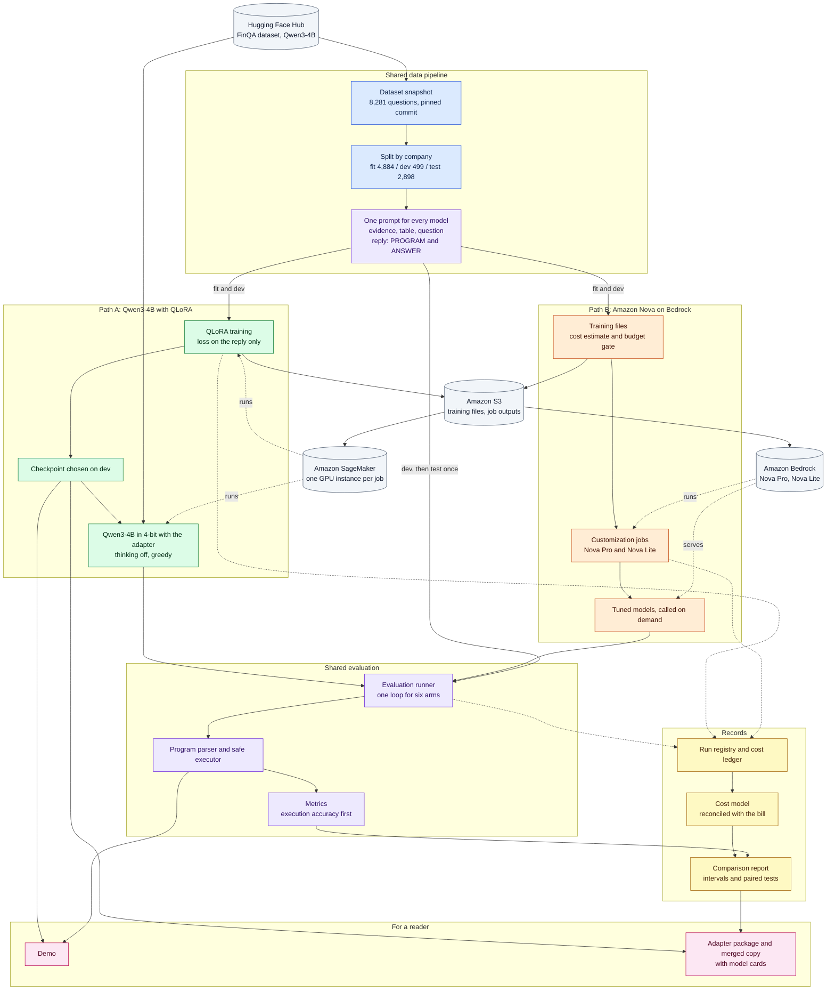
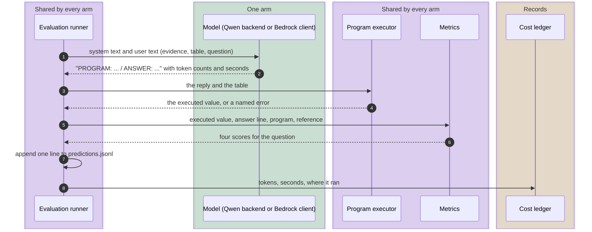

# qlora_finetuning

> **This is a public snapshot of a private repository.** The AWS account number in every file is a placeholder, the committed reports and records were redacted and not rebuilt, and some folders were left out. See [PUBLIC_SNAPSHOT.md](PUBLIC_SNAPSHOT.md).

**One question, measured:** for turning a question about a company's financial report into
a short program that computes the answer, how does a small open model tuned with QLoRA
compare with a hosted model tuned by its provider, in accuracy and in cost?

- **Path A** tunes [Qwen3-4B](https://huggingface.co/Qwen/Qwen3-4B) with QLoRA. The result
  is an adapter file the owner holds and can publish.
- **Path B** tunes Amazon Nova Pro and Nova Lite on Amazon Bedrock. The result is a hosted
  model that cannot be downloaded.
- Both are trained on the same questions of [FinQA](https://github.com/czyssrs/FinQA), read
  the same prompt, and are scored by the same code on the same 2,898 held-out questions.

The model does not do the arithmetic. It writes a program, and the project's executor runs
it:

```
Question: what was the percentage change in net revenue from 2023 to 2024?

PROGRAM: subtract(4812, 4275), divide(#0, 4275)        -> executed: 0.1256140350877193
ANSWER: 0.12556
```

## Contents

- [Results](#results)
- [How it works](#how-it-works)
- [The demo](#the-demo)
- [The tuned model](#the-tuned-model)
- [Setup](#setup)
- [Reproducing it](#reproducing-it)
- [What is where](#what-is-where)
- [Limits](#limits)
- [Licences and citation](#licences-and-citation)

<!-- comparison:start -->
## Results

Six arms on the 2,898 test questions, each run once. Intervals are 95% confidence intervals, in percent; costs are at list price.

| Arm | Model | Execution accuracy | Interval | Per 1,000 questions | Per 1,000 correct answers |
|---|---|---:|---:|---:|---:|
| A0 | Qwen3-4B, untuned | 0.93% | 0.59 to 1.31 | $0.562 | $60.32 |
| A1 | Qwen3-4B with QLoRA | 73.19% | 71.60 to 74.78 | $0.346 | $0.473 |
| B0-Lite | Nova Lite, untuned | 16.70% | 15.36 to 18.08 | $0.047 | $0.283 |
| B0-Pro | Nova Pro, untuned | 35.37% | 33.64 to 37.09 | $0.624 | $1.76 |
| B1-Lite | Nova Lite, tuned | 71.39% | 69.74 to 73.02 | $0.044 | $0.062 |
| B1-Pro | Nova Pro, tuned | 75.19% | 73.60 to 76.74 | $0.590 | $0.784 |

- **Tuning is the large effect.** It raised execution accuracy in all 3 models, by 39.82 to 72.26 points, and every gain is settled.
- **The tuned arms, by execution accuracy:** B1-Pro 75.19%, A1 73.19% and B1-Lite 71.39%.
- **Cost per 1,000 questions, tuned arms:** B1-Lite $0.044, A1 $0.346 and B1-Pro $0.590. A Qwen arm's figure is the batch job that was paid for.

The full report, with the tests between arms, the cost model, the error categories, and the caveats: [reports/comparison_report.md](reports/comparison_report.md).

This section is written by `python -m scripts.comparison_report build`; do not edit between the markers.
<!-- comparison:end -->

Three things the table does not show are in the report: which differences between the
tuned models are settled and which are not, at how many questions a month one path becomes
cheaper than the other, and who holds the tuned model at the end.

## How it works

### The whole system

Two training paths share one data pipeline, one prompt, and one scorer. Everything that
produces a reported number runs in AWS; the local machine prepares data, starts jobs,
scores, and writes the reports.



| Colour | Kind |
|---|---|
| Blue | Data: the snapshot and the split |
| Purple | Shared by every model: the prompt, the runner, the executor, the metrics |
| Green | Path A: Qwen3-4B with QLoRA |
| Orange | Path B: Amazon Nova on Bedrock |
| Yellow | Records: the ledger, the cost model, the report |
| Pink | What a reader picks up: the demo and the packages |
| Grey | Services outside the repository |

### One question through the system

The same steps for every one of the six arms. Only the model in the middle differs.



Three rules hold the comparison together:

- **One prompt.** Every model receives the same system text and the same layout of
  evidence, table, and question. The wording lives in `config/prompt.yaml`, not in code.
- **One scorer.** A reply is parsed and executed by `qlora_finetuning/dsl/` and scored by
  `qlora_finetuning/evaluation/`, whatever model wrote it. No reply is ever passed to `eval`.
- **One look at the test split.** The split is by company. Every setting was chosen on the
  development questions, each arm's configuration was frozen, and then each arm answered
  the test questions once.

The longer description is in
[architecture/architecture_overview.md](architecture/architecture_overview.md).

## The demo

Ask the tuned model one question about a table and see the program it proposes, the
executed result, and whether the model's own answer agrees. It runs on a local GPU, costs
nothing, and makes no AWS call:

```powershell
venv\Scripts\python -m qlora_finetuning.demo                       # the bundled sample
venv\Scripts\python -m qlora_finetuning.demo --show-input          # with the table and context
venv\Scripts\python -m qlora_finetuning.demo --input my_question.json
venv\Scripts\python -m qlora_finetuning.demo --check               # no model is loaded
```

What it needs, the input file's format, and how to read the output are in
[docs/runbook.md](docs/runbook.md), section 10. It is a demonstration,
not a measurement.

## The tuned model

Path A's result is packaged for the Hugging Face Hub in two forms:

| Package | What it is | Loads with |
|---|---|---|
| `sudiptoHaldar/qwen3-4b-finqa-program-qlora` | The adapter that was measured (arm A1): 66 MB of weights, 82 MB with its tokenizer | `peft`, on top of `Qwen/Qwen3-4B` |
| `sudiptoHaldar/qwen3-4b-finqa-program-merged` | The base model with the adapter merged into its weights, 8 GB | `transformers` alone |

Each has a model card, built from the committed records:
[reports/packaging/adapter_card.md](reports/packaging/adapter_card.md) and
[reports/packaging/merged_card.md](reports/packaging/merged_card.md). The code printed on
each card is executed before the card is accepted.
[reports/packaging/package_record.md](reports/packaging/package_record.md) lists what each
package holds and the checks it passed.

Uploading is a separate step by the owner. Until the two repositories exist, build the
packages locally:

```powershell
venv\Scripts\python -m scripts.hf_package status
```

> **Do not report the tuned model's score on the official FinQA test split.** The training
> questions were drawn from all of FinQA, the official validation and test files included,
> and split again by company. The split manifest says which question was used for what.

The tuned Nova models stay inside Amazon Bedrock and cannot be published.

## Setup

The project was built on Windows 11 with Python 3.13. Commands are written for PowerShell.

```powershell
python -m venv venv
venv\Scripts\python -m pip install -r requirements.txt
venv\Scripts\python -m pytest -q                 # no GPU, no network, no credentials
venv\Scripts\python -m ruff check .
```

That is enough to read the code, run the tests, and rebuild the reports from stored runs.
Two more things are needed only for the steps that use them:

| For | Needs |
|---|---|
| Asking the Qwen model locally (the demo, a local run) | A CUDA GPU with about 6 GB of memory free, and the training libraries of `requirements-train.txt`; check with `venv\Scripts\python -m scripts.env_check` |
| Anything in AWS (training, the measured runs, Bedrock) | Your own AWS account, with its own bucket, roles, and budget in `config/aws.yaml`; check with `venv\Scripts\python -m scripts.aws_check` |

## Reproducing it

Every stage is one command. The runbook has the options, the checks, and what to do when
one fails. The stages that are billed are started by a person, with `--yes`, never by a
script running another script.

| Stage | Command | Where | Cost here |
|---|---|---|---|
| Fetch FinQA at the pinned commit | `python -m scripts.finqa_fetch` | local | free |
| Split by company, freeze the manifest | `python -m scripts.finqa_split` | local | free |
| Check the reference programs with the executor | `python -m scripts.finqa_gold_check` | local | free |
| Write the prompts; count tokens | `python -m scripts.finqa_serialize`, `python -m scripts.finqa_tokens` | local | free |
| Train Qwen3-4B with QLoRA | `python -m scripts.sagemaker_job` | SageMaker | $5.88 |
| Score the checkpoints, choose one | `python -m scripts.sagemaker_job`, `python -m scripts.qlora_select` | SageMaker, local | $1.94 |
| Export the Bedrock training files | `python -m scripts.nova_export` | local | free |
| Tune Nova Pro and Nova Lite | `python -m scripts.nova_tune` | Bedrock | $73.35 |
| Freeze every arm, unlock the test split | `python -m scripts.comparison_freeze` | local | free |
| Answer the test questions, six arms | `python -m scripts.sagemaker_job`, `python -m scripts.evaluate` | SageMaker, Bedrock | $2.63 for Path A, $3.78 for Path B |
| Price every run | `python -m scripts.comparison_cost` | local | free |
| Write the comparison report | `python -m scripts.comparison_report` | local | free |
| Package the tuned model | `python -m scripts.hf_package` | local | free |

Development runs outside these stages cost a further $0.420 for Path A and $0.951 for
Path B. In all: $10.87 for Path A and
$78.08 for Path B, at the prices of November 2026, plus $1.95 a month for each tuned Nova
model while it exists. The figures are from
[reports/comparison/cost_model.md](reports/comparison/cost_model.md), which is reconciled
with the AWS bill.

Rebuilding the report from stored runs needs the runs' reply files, which are kept outside
the repository: a reply to a FinQA question is dataset text, and none is committed.

The public repository, `SudiptoHaldar/qlora_finetuning_public`, is a copy of a private one, made with
`python -m scripts.public_export`; changes are made in the private repository and exported.

## What is where

| Folder | Holds |
|---|---|
| `qlora_finetuning/data/` | The dataset snapshot, the split, the prompt writer, the token budget |
| `qlora_finetuning/dsl/` | The program language: parser, safe executor, reply reader |
| `qlora_finetuning/evaluation/` | The runner, the metrics, the failure categories |
| `qlora_finetuning/local_qlora/` | Path A: the Qwen backend, QLoRA training, the SageMaker launcher, checkpoint selection |
| `qlora_finetuning/frontier/` | Path B: the Bedrock client, the training files, job control |
| `qlora_finetuning/comparison/` | The freeze, the gate on the test split, the cost model, the report |
| `qlora_finetuning/demo/`, `qlora_finetuning/packaging/` | The demo, and the packages with their model cards |
| `qlora_finetuning/public_export/` | The tool that makes the public copy of the repository |
| `qlora_finetuning/tracking/` | The run registry and the cost ledger |
| `scripts/` | One command per stage |
| `config/` | Every setting: the prompt, the split, training, prices, the comparison |
| `splits/` | The committed split manifest, the freeze record, the unlock record |
| `reports/` | Generated reports: data, each path, the comparison, the packages |
| `ledger/` | What every run consumed, as quantities |
| `reqspecs/` | The plan, the specifications, and the working notes of each version |
| `tests/` | The test suite; it needs no GPU, no network, and no credentials |

## Limits

- **The evidence is given.** Every model received the passages FinQA marks as the evidence
  for a question, at training and at test time. Finding the evidence is not measured, so
  the figures are not comparable with published FinQA results.
- **One dataset, one task, one prompt, one training run per tuned model.** A difference of
  a few points between the tuned models could be within what another seed would give.
- **Prices and limits are one account's, in one month.**
- **A research project, not financial advice.**

The report lists the rest, and every deviation from the plan:
[reports/comparison_report.md](reports/comparison_report.md), sections 10 and 11.

## Licences and citation

The code is under the MIT License ([LICENSE](LICENSE)). What it builds on:

| What | Licence |
|---|---|
| Qwen3-4B, the base model of Path A | Apache License 2.0 |
| FinQA, the questions, programs, and answers | MIT License |
| FinTabNet, the report tables FinQA is built on | CDLA-Permissive-1.0 |
| Amazon Nova | Used under the AWS service terms; not redistributed |

The tuned adapter and the merged copy are released under the Apache License 2.0, as the
base model is. The dates each licence was read, and what its source said, are in
[reports/packaging/package_record.md](reports/packaging/package_record.md).

```bibtex
@article{chen2021finqa,
  title={FinQA: A Dataset of Numerical Reasoning over Financial Data},
  author={Chen, Zhiyu and Chen, Wenhu and Smiley, Charese and Shah, Sameena and Borova, Iana and Langdon, Dylan and Moussa, Reema and Beane, Matt and Huang, Ting-Hao and Routledge, Bryan and Wang, William Yang},
  journal={Proceedings of EMNLP 2021},
  year={2021}
}
```
