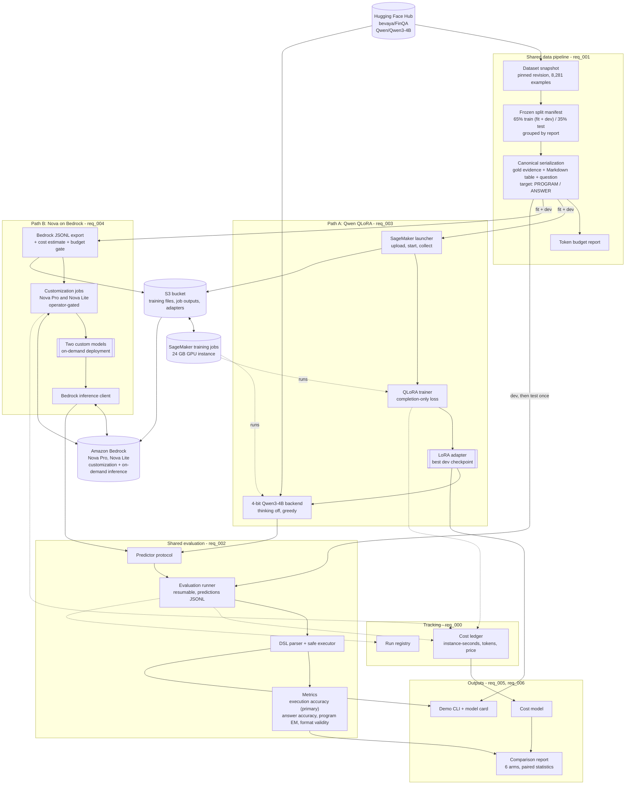
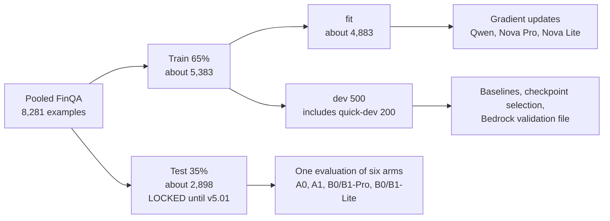
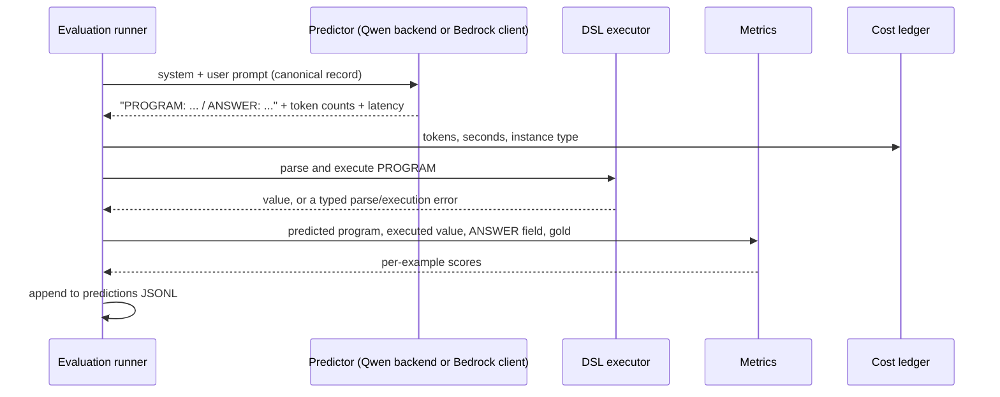
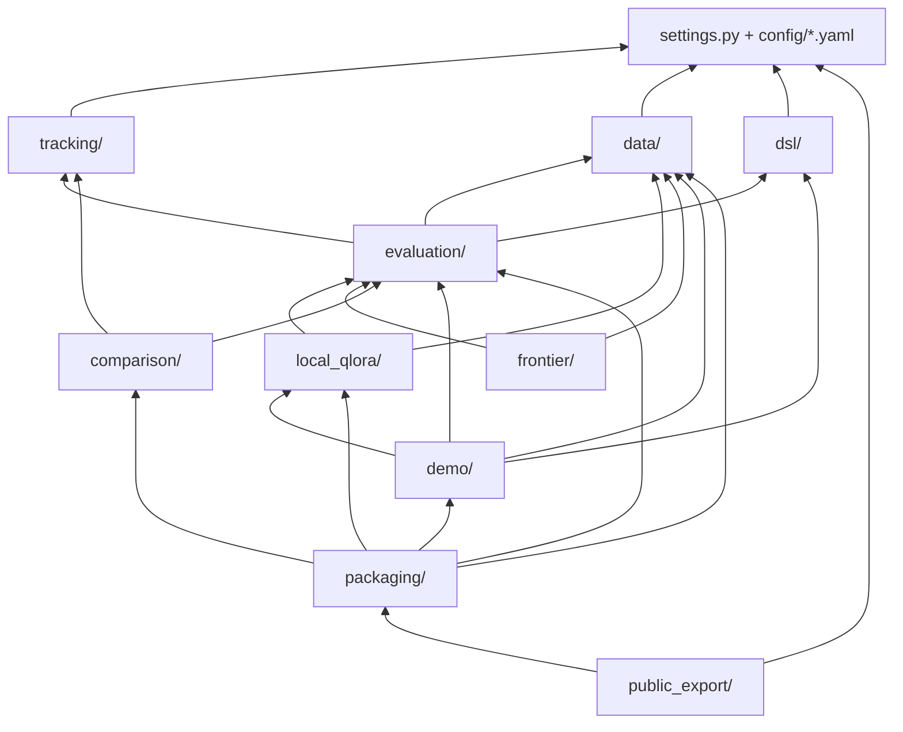

# Architecture overview — QLoRA Finetuning

**Version**: 0.2 (initial sketch, revised)  
**Created**: 2026-11-13  
**Revised**: 2026-11-14 — Qwen path runs on SageMaker; hosted path is Nova Pro and Nova Lite on Bedrock; S3 added.  
**Status**: initial sketch from the planning documents. No code exists yet; module names are the
targets set in `reqspecs/0. PLANNING/high_level_plan.md` §5. A detailed version follows once
`req_000`–`req_002` have fixed the interfaces.

The diagrams are Mermaid and render in VS Code (Markdown preview) and on GitHub.

---

## 1. System view

Two training paths share one data pipeline, one output contract, and one scorer. Only the boxes
inside "Path A" and "Path B" differ. Everything that produces a reported number runs in AWS
(us-east-1); the local machine prepares data, launches jobs, scores, and reports.

## 2. Data split and the test lock

Counts are approximate because whole reports are assigned together. The manifest
(`example_id → fit | dev | test`) is committed; loaders refuse test rows unless the caller holds
the unlock recorded by `req_005` v5.01, and no test row is uploaded to S3 before then.

## 3. One example through the system

## 4. Package dependencies (target)

Arrows point from a module to what it imports. Nothing imports upward; the two path packages do
not import each other.

## 5. Where things live at runtime

| Artifact | Location | In git |
|---|---|---|
| Dataset snapshot (Parquet) | `artifacts/data/` | No |
| Split manifest | `config/` (or `qlora_finetuning/data/`, decided in v1.02) | **Yes** |
| Prompt template, training and pricing config | `config/*.yaml` | **Yes** |
| Model weights cache | Hugging Face cache | No |
| Run directories (logs, checkpoints, predictions) | `artifacts/runs/<run_id>/` | No |
| Selected LoRA adapter | S3, mirrored to `artifacts/adapters/` | No |
| Training files and job outputs | S3 bucket (us-east-1), private | No |
| Custom Nova models | Bedrock (ARNs recorded in the ledger) | No |
| Cost ledger | `artifacts/ledger/` (summary copied into `reports/`) | Summary only |
| Comparison report and figures | `reports/` | **Yes** |
| The adapter package and the merged copy | `artifacts/release/` | No |
| The model cards and the package record | `reports/packaging/` | **Yes** |
| The public copy of the repository | A folder outside this repository; its own git repository | Its own |
| The record of the last public export | `reports/public_export/` | **Yes** |
| AWS credentials | AWS CLI profile | No |

## 6. To be detailed in the next version

- **The public copy of the repository is built** (req_006 v6.04, `qlora_finetuning/public_export/`): `source.py` reads a commit's files with `git archive`; `transform.py` sorts them into kept, moved, and left out, applies the literal replacements and path rewrites of `config/public_export.yaml`, and generates the snapshot notice; `build.py` writes the copy into a folder outside this repository and removes only what a previous export wrote; `checks.py` compares that folder byte for byte with what its commit exports, scans it for private strings, runs lint and the suite in a temporary copy, and writes `reports/public_export/export_record.json`; `snapshot.py` lets `tests/conftest.py` skip the tests marked `private_records` where the notice is present. `scripts/public_export.py` is the command. The public repository is a product of this one, never a source.
- **The packages and their model cards are built** (req_006 v6.02, `qlora_finetuning/packaging/`): `sources.py` finds the checkpoint the selection record names and checks its hash; `adapter_package.py` writes the adapter package under git-ignored `artifacts/release/adapter/`; `merge.py`, the one module of the package that loads the training stack, adds the adapter to the full-precision base weights on the CPU, and `merged_package.py` writes the merged copy with Qwen's licence and a notice; `predictors.py` puts both behind the ordinary runner as three predictors that are no arms and are refused on test (`backend.py` gained `load_folder_backend` for a model saved in a folder, 4-bit or not quantized); `verify.py` finds the dev runs, compares their replies with the adapter's, and executes a card's code in an empty directory; `cards.py` fills the two card templates from the committed records; `record.py` runs checks P1 to P10 and writes `reports/packaging/package_record.json`. `scripts/hf_package.py` is the command. Nothing is uploaded.
- **The optional local full run has its tooling, and has not been made** (req_003 v3.06). The run
  is `scripts/qlora_train.py`, unchanged. Around it, `local_qlora/local_run.py` checks the machine
  before a start (`preflight`: the plan, a clean tree, free GPU memory, disk, power, nothing to
  resume) and follows a run (`run_status`); `local_qlora/local_note.py` writes the committed
  `reports/local_qlora/local_run.json`, with a local-against-cloud section once a cloud checkpoint
  is selected. `scripts/qlora_local.py` is the command for all three. A local run is a side note:
  the selection refuses it, and nothing reads its note as arm A1.
- **The error analysis and the one corrective iteration are built, and nothing has triggered them**
  (req_003 v3.05). `evaluation/failures.py` gives each wrong reply of any stored run one computed
  category. `local_qlora/analysis.py` (`scripts/qlora_analyze.py`) turns the selection's runs into
  the committed `reports/local_qlora/error_analysis.json`: categories for the selected checkpoint,
  the untuned model, and every checkpoint, where the failures sit, and a finding. If the verdict is
  `missed`, `local_qlora/iteration.py` (`scripts/qlora_iterate.py`) registers one changed training
  setting in `reports/local_qlora/iteration.json`; the launcher's check J10 admits one second run;
  and `selection.py`, whose reading of the scored runs is now `gather_scored`, compares the second
  run with the selected checkpoint and writes a record that names the winner and lists both.
- **The full run's tooling is built, and no job has run** (req_003 v3.04). A fourth task, `score`
  (`local_qlora/job.py`), scores the untuned model and every checkpoint of a training run in one job,
  each as an ordinary evaluation run, finding what is already scored through `local_qlora/scoring.py`.
  `local_qlora/estimate.py` turns the seconds a pulled job measured into hours and dollars for the
  plan (check J9). `local_qlora/selection.py` (`scripts/qlora_select.py`) reads the pulled runs,
  checks them (L1 to L6), chooses the checkpoint with the best execution accuracy on dev, and writes
  the committed selection record `reports/local_qlora/adapter_selection.json`: the one place that
  says which run is arm A1. `--adapter selected` resolves through it; the launcher's
  `pull --checkpoint` and `keep` fetch that adapter and store it under `adapters/` in the bucket.
- **SageMaker job packaging is built and proven by a smoke job in AWS on 2026-11-20** (req_003 v3.03): a job is given the
  code as `git archive` of a commit, a data bundle of `fit` and `dev` (`data/bundle.py`; the snapshot,
  which holds the test rows, never leaves the machine), and an S3 workspace. In the job,
  `scripts/job_bootstrap.sh` links `artifacts/` and `ledger/` into the checkpoint folder that
  SageMaker keeps in step with the workspace, installs the pinned libraries over AWS's PyTorch
  container, downloads the model, and runs `scripts/job_run.py` (`local_qlora/job.py`: tasks `smoke`,
  `train`, `evaluate`, calling `run_training` and `run_evaluation` unchanged). `local_qlora/sagemaker.py`
  plans a job (checks J1 to J8, a Path A cap), launches it for the owner, follows it, and pulls its
  runs, ledger lines, and billable seconds home; `reports/local_qlora/sagemaker_jobs.json` records
  every job. `qlora_finetuning/aws_common.py` holds the sign-in helpers both paths share.
- **The QLoRA training pipeline is built** (req_003 v3.02): `render.py` encodes a record as the
  sequence the token budget counted, labelled on the reply only; `plan.py` holds the step, warmup,
  and checkpoint arithmetic; `training.py` runs one training as one run in the registry (worst-batch
  probe, TRL's `SFTTrainer` on a prepared dataset with every argument from `config/training.yaml`,
  a log, checkpoints, a ledger record with training tokens, resuming as a new run) and is the second
  module that loads the training stack; `adapters.py` keeps each finished adapter with metadata that
  says what it was trained for. `scripts/qlora_train.py` is the entry point (dry run, smoke run with
  checks K1 to K7, resume), and `scripts.evaluate --predictor qwen3-4b-tuned --adapter <run>` scores
  an adapter or a checkpoint through the ordinary runner. No full run has been made yet.
- **The Qwen inference backend is built** (req_003 v3.01, `qlora_finetuning/local_qlora/`):
  `render.py` wraps the canonical system and user texts in the chat template with thinking off and
  reads a row of generated ids back into reply text, token count, and stop reason; `backend.py`
  loads the pinned model in 4-bit NF4 from the local cache (optionally with a LoRA adapter, not
  merged) and generates greedily in left-padded batches, stopping only at the model's end tokens or
  the reply limit, and is the only Path A module that loads the training stack; `QwenPredictor`
  puts it behind the `Predictor` protocol with measured token counts. The runner stores what a
  predictor's optional `measurements()` returns (peak GPU memory, speed) in the run folder. The
  SageMaker launcher is described above.
- **`FrontierProvider` is built in its first form** (req_004 v4.01, `qlora_finetuning/frontier/`): one
  method, `converse(model_id, system, user, max_tokens)`, returning the reply text, the service's own
  token counts, a stop reason, and the latency. `BedrockProvider` implements it over the Converse API
  (texts unchanged, temperature 0, `topK` 1, botocore's retries) and is the only module that loads
  boto3. `FrontierPredictor` puts a provider behind the `Predictor` protocol, one call per request,
  so the runner records Bedrock's token counts in the ledger. The job and deployment methods are added
  by v4.03. Prices are read from `config/pricing.yaml`.
- **The tuned-model evaluation is built** (req_004 v4.04): `tuned.py` decides which attempt of the
  tuning record is this experiment's tuned model and refuses any other; `build_tuned_predictor`
  gives the existing `FrontierPredictor` that attempt's deployment ARN as its model id, after one
  read from Bedrock that the deployment is Active. A predictor may now name a `usage_model_id`,
  the id the runner records usage under, because a tuned model is called by an ARN and billed as
  its base model. `tuned_report.py` pairs each tuned run with its baseline run, counts the
  questions tuning fixed and broke, and gives a verdict per model from dev against the thresholds
  in `config/frontier.yaml`; `scripts/nova_tuned.py` writes it to
  `reports/frontier/nova_tuned_report.json`. A missed verdict starts nothing.
- **Job control is built** (req_004 v4.03): `tuning.py` holds `BedrockTuning` over a Bedrock
  control-plane client and an S3 client, both passed in. `plan` and nine checks (T1 to T9) read
  only; `launch` creates one job per command with a request token, adopting a job that already
  exists with that token; `refresh` reads the jobs and deployments and fetches the loss curves;
  `deploy`, `stop`, `bill`, and `teardown` do what their names say. The committed tuning record
  `reports/frontier/nova_tuning.json` (`tuning_record.py`) holds the job, model, and deployment
  ARNs. **A departure from the plan**: job control is a class of its own, not part of
  `FrontierProvider`, which stays the inference interface; there is one provider, and an
  interface for calls only it makes would be a guess.
- **The training files and the budget gate are built** (req_004 v4.02): `export.py` renders fit and dev
  once as Bedrock conversation lines (the same texts in the same places as a question) under
  git-ignored `artifacts/bedrock/<export id>/`; `export_validation.py` reads them back and runs checks
  X1 to X7 (same records, no test id, format, reserved words, limits, same prompt and split,
  reproducible); `training_estimate.py` prices Path B from the Qwen token volume, the Nova to Qwen
  ratio measured by the v4.01 baselines, and `config/pricing.yaml`, and writes the committed gate record
  `reports/frontier/nova_training_gate.json`; `staging.py` uploads the files to
  `s3://<bucket>/data/bedrock/<export id>/` with SHA-256 checksums and reads them back. v4.03 starts a
  job only with a gate record that says passed for the files in S3.
- Concrete interfaces still open: ledger record schema, manifest schema. **`Predictor` is built**
  (req_002 v2.03, `qlora_finetuning/evaluation/predictor.py`): `predict(requests) -> predictions`, a list
  in and a list out, where a request is the canonical record's system and user texts with the reply
  limit, and a prediction is the reply text, token counts, latency, and stop reason. The runner writes
  `artifacts/runs/<run_id>/predictions.jsonl` and one line of counts per result in the committed
  `ledger/evaluations.jsonl`.
- The Bedrock customization and on-demand deployment lifecycle for Nova Pro and Nova Lite.
- The SageMaker job definition: container, instance type, S3 channels, IAM role (Q8, Q9).
- AWS account view: bucket layout, roles, quotas, budget alarm.
- The cost-model formulas with the configured rates and utilization scenarios (Q10).
