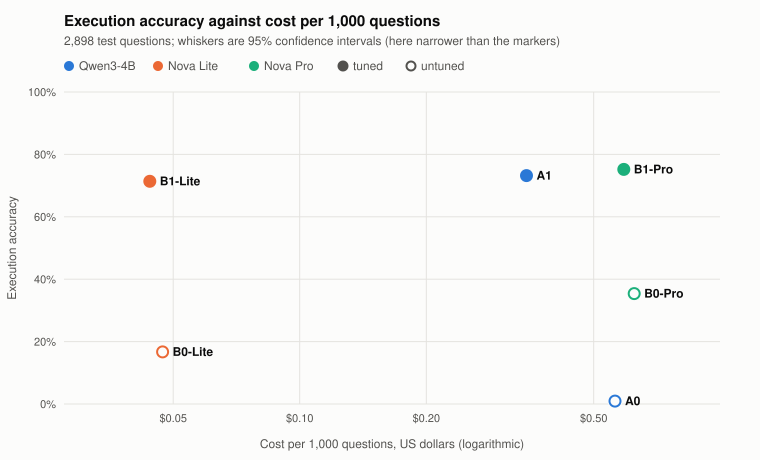

# The comparison

Generated by `python -m scripts.comparison_report build`. Do not edit by hand: change the template or a record and
build again. This file holds counts and figures only: no question, no reply, no gold text.

The cost record this report reads is reconciled with the AWS bill.

The project asks one question: for turning a financial question into a short program, how
does a small open model tuned with QLoRA (Path A) compare with a hosted model tuned by its
provider (Path B), in accuracy and in cost?

## 1. Summary

| Arm | Model | Execution accuracy | Interval | Per 1,000 questions | Per 1,000 correct answers |
|---|---|---:|---:|---:|---:|
| A0 | Qwen3-4B, untuned | 0.93% | 0.59 to 1.31 | $0.562 | $60.32 |
| A1 | Qwen3-4B with QLoRA | 73.19% | 71.60 to 74.78 | $0.346 | $0.473 |
| B0-Lite | Nova Lite, untuned | 16.70% | 15.36 to 18.08 | $0.047 | $0.283 |
| B0-Pro | Nova Pro, untuned | 35.37% | 33.64 to 37.09 | $0.624 | $1.76 |
| B1-Lite | Nova Lite, tuned | 71.39% | 69.74 to 73.02 | $0.044 | $0.062 |
| B1-Pro | Nova Pro, tuned | 75.19% | 73.60 to 76.74 | $0.590 | $0.784 |

Intervals are 95% confidence intervals, in percent. Costs are at list price.

- **Tuning is the large effect.** It raised execution accuracy in all 3 models, by 39.82 to 72.26 points, and every gain is settled.
- **The tuned arms, by execution accuracy:** B1-Pro 75.19%, A1 73.19% and B1-Lite 71.39%.
- B1-Pro is ahead of A1 by 2.00 points (interval by example 0.66 to 3.31, by company 0.17 to 3.55; adjusted p 0.0072). The difference is settled: it holds under both intervals.
- A1 is ahead of B1-Lite by 1.79 points (interval by example 0.38 to 3.21, by company -0.03 to 3.52; adjusted p 0.0132). The difference is **not settled**: the interval by company includes zero.
- B1-Pro is ahead of B1-Lite by 3.80 points (interval by example 2.48 to 5.11, by company 2.24 to 5.17; adjusted p below 0.0001). The difference is settled: it holds under both intervals.
- **Cost per 1,000 questions, tuned arms:** B1-Lite $0.044, A1 $0.346 and B1-Pro $0.590. A Qwen arm's figure is the batch job that was paid for.
- **A1 against B1-Lite, batch job, a month:** 7,059 questions: below it A1 is cheaper, above it B1-Lite.
- **A1 against B1-Lite, with the cost of making the model:** 26,239 questions: below it A1 is cheaper, above it B1-Lite.
- **A1 against B1-Pro, batch job, a month:** A1 is cheaper at every volume.
- **A1 against B1-Pro, with the cost of making the model:** A1 is cheaper at every volume.
- **An always-on endpoint does not pay off in this account:** every break-even needs more questions a month than the account may send to the Nova model, or than one instance can answer.

Which path fits depends on three things the tables below answer: how many questions there
are in a month (section 5), what a point of accuracy is worth (sections 3 and 4), and who
must hold the tuned model (section 9). The report names no single winner.

## 2. What was compared

The task is FinQA: a question about a company's financial report, with the supporting
passages and the table. A model answers with a short program and an answer; the program is
executed, and its result is compared with the gold result.

| Arm | Model | Path | Tuned |
|---|---|---|---|
| A0 | Qwen3-4B, untuned | A | no |
| A1 | Qwen3-4B with QLoRA | A | yes |
| B0-Lite | Nova Lite, untuned | B | no |
| B0-Pro | Nova Pro, untuned | B | no |
| B1-Lite | Nova Lite, tuned | B | yes |
| B1-Pro | Nova Pro, tuned | B | yes |

- **One prompt, one scorer.** Every arm received the same prompt wording and its replies
  were read and scored by the same code.
- **The split is by company.** No company has questions on both sides. The test split has
  2,898 questions from 43 companies; dev has 499.
- **One test pass.** Each arm's configuration was frozen (freeze record `1785a84a3817ca63878462a91178d28e6d35762a3896e2afb5abd62658f64ea4`)
  before the test split was unlocked, and each arm answered the test questions once. Every
  choice of prompt, checkpoint, and setting was made on dev.

## 3. Accuracy

Execution accuracy is the primary metric: the predicted program runs and gives the gold
result within the allowance.

| Arm | Right | Execution accuracy | Interval by example | Interval by company |
|---|---:|---:|---:|---:|
| A0 | 27 | 0.93% | 0.59 to 1.31 | 0.40 to 1.56 |
| A1 | 2,121 | 73.19% | 71.60 to 74.78 | 69.63 to 76.47 |
| B0-Lite | 484 | 16.70% | 15.36 to 18.08 | 14.66 to 18.61 |
| B0-Pro | 1,025 | 35.37% | 33.64 to 37.09 | 32.23 to 37.87 |
| B1-Lite | 2,069 | 71.39% | 69.74 to 73.02 | 67.78 to 74.91 |
| B1-Pro | 2,179 | 75.19% | 73.60 to 76.74 | 72.11 to 77.69 |

An interval is a paired percentile bootstrap with 10,000 resamples (seed 20261115).
*By example* resamples the questions. *By company* resamples whole companies, because
questions about one company's report resemble each other; it is the wider of the two and
the more cautious.

All four metrics, with the interval by example:

| Arm | Execution accuracy | Answer accuracy | Program match | In the format |
|---|---:|---:|---:|---:|
| A0 | 0.93% (0.59 to 1.31) | 11.04% (9.94 to 12.22) | 0.03% (0.00 to 0.10) | 90.75% (89.65 to 91.82) |
| A1 | 73.19% (71.60 to 74.78) | 66.98% (65.29 to 68.67) | 68.05% (66.36 to 69.74) | 100.00% (100.00 to 100.00) |
| B0-Lite | 16.70% (15.36 to 18.08) | 28.64% (27.02 to 30.30) | 14.01% (12.73 to 15.29) | 95.38% (94.58 to 96.14) |
| B0-Pro | 35.37% (33.64 to 37.09) | 46.38% (44.55 to 48.14) | 29.33% (27.67 to 31.02) | 99.72% (99.52 to 99.90) |
| B1-Lite | 71.39% (69.74 to 73.02) | 70.29% (68.60 to 71.91) | 66.11% (64.39 to 67.81) | 100.00% (100.00 to 100.00) |
| B1-Pro | 75.19% (73.60 to 76.74) | 73.81% (72.22 to 75.43) | 68.98% (67.25 to 70.60) | 100.00% (100.00 to 100.00) |

Dev beside test, for execution accuracy. Dev is where each arm's settings were chosen:

| Arm | Dev, right | Dev | Test, right | Test | Test minus dev, points |
|---|---:|---:|---:|---:|---:|
| A0 | 6 of 499 | 1.20% | 27 of 2,898 | 0.93% | -0.27 |
| A1 | 358 of 499 | 71.74% | 2,121 of 2,898 | 73.19% | +1.45 |
| B0-Lite | 123 of 499 | 24.65% | 484 of 2,898 | 16.70% | -7.95 |
| B0-Pro | 190 of 499 | 38.08% | 1,025 of 2,898 | 35.37% | -2.71 |
| B1-Lite | 329 of 499 | 65.93% | 2,069 of 2,898 | 71.39% | +5.46 |
| B1-Pro | 359 of 499 | 71.94% | 2,179 of 2,898 | 75.19% | +3.25 |

## 4. Between arms

All arms answered the same questions, so two arms are compared question by question.
*Only the first* counts the questions the first arm got right and the second wrong. The
test is McNemar's exact test on those two counts. The 6 pairs below were named
after the counts of the six test runs were known, and their p-values are adjusted together
with Holm's method.

A difference is called **settled** when its adjusted p-value is below the level the
intervals use and neither interval includes zero. Otherwise it is **not settled**, whatever
its p-value.

| Pair | Both right | Only the first | Only the second | Both wrong | Difference, points | Interval by example | Interval by company | p | p, adjusted | Verdict |
|---|---:|---:|---:|---:|---:|---:|---:|---:|---:|---|
| A1 minus A0 | 25 | 2,096 | 2 | 775 | +72.26 | 70.63 to 73.84 | 68.76 to 75.40 | below 0.0001 | below 0.0001 | settled |
| B1-Lite minus B0-Lite | 452 | 1,617 | 32 | 797 | +54.69 | 52.76 to 56.56 | 51.14 to 58.54 | below 0.0001 | below 0.0001 | settled |
| B1-Pro minus B0-Pro | 974 | 1,205 | 51 | 668 | +39.82 | 37.89 to 41.75 | 37.00 to 43.04 | below 0.0001 | below 0.0001 | settled |
| A1 minus B1-Pro | 1,958 | 163 | 221 | 556 | -2.00 | -3.31 to -0.66 | -3.55 to -0.17 | 0.0036 | 0.0072 | settled |
| A1 minus B1-Lite | 1,883 | 238 | 186 | 591 | +1.79 | 0.38 to 3.21 | -0.03 to 3.52 | 0.0132 | 0.0132 | **not settled** |
| B1-Pro minus B1-Lite | 1,934 | 245 | 135 | 584 | +3.80 | 2.48 to 5.11 | 2.24 to 5.17 | below 0.0001 | below 0.0001 | settled |

- A1 is ahead of A0 by 72.26 points (interval by example 70.63 to 73.84, by company 68.76 to 75.40; adjusted p below 0.0001). The difference is settled: it holds under both intervals.
- B1-Lite is ahead of B0-Lite by 54.69 points (interval by example 52.76 to 56.56, by company 51.14 to 58.54; adjusted p below 0.0001). The difference is settled: it holds under both intervals.
- B1-Pro is ahead of B0-Pro by 39.82 points (interval by example 37.89 to 41.75, by company 37.00 to 43.04; adjusted p below 0.0001). The difference is settled: it holds under both intervals.
- B1-Pro is ahead of A1 by 2.00 points (interval by example 0.66 to 3.31, by company 0.17 to 3.55; adjusted p 0.0072). The difference is settled: it holds under both intervals.
- A1 is ahead of B1-Lite by 1.79 points (interval by example 0.38 to 3.21, by company -0.03 to 3.52; adjusted p 0.0132). The difference is **not settled**: the interval by company includes zero.
- B1-Pro is ahead of B1-Lite by 3.80 points (interval by example 2.48 to 5.11, by company 2.24 to 5.17; adjusted p below 0.0001). The difference is settled: it holds under both intervals.

The other pairs, as counts only:

| Pair | Both right | Only the first | Only the second | Both wrong |
|---|---:|---:|---:|---:|
| A0 and B0-Lite | 6 | 21 | 478 | 2,393 |
| A0 and B0-Pro | 13 | 14 | 1,012 | 1,859 |
| A0 and B1-Lite | 25 | 2 | 2,044 | 827 |
| A0 and B1-Pro | 25 | 2 | 2,154 | 717 |
| A1 and B0-Lite | 440 | 1,681 | 44 | 733 |
| A1 and B0-Pro | 922 | 1,199 | 103 | 674 |
| B0-Lite and B0-Pro | 344 | 140 | 681 | 1,733 |
| B0-Lite and B1-Pro | 446 | 38 | 1,733 | 681 |
| B0-Pro and B1-Lite | 926 | 99 | 1,143 | 730 |

Of the 2,898 test questions, 1,807 are right in all the tuned arms (A1, B1-Lite and B1-Pro) and 2,401 in at least one of them. 467 are right in none of the 6 arms.

## 5. Cost

Every figure comes from the cost record (`reports/comparison/cost_model.md`), which has the
method, the checks, and the comparison with the AWS bill. Prices: the Bedrock price list published 2026-11-11; the SageMaker training price list of 2026-11-14 and hosting price list of 2026-11-23. Runs are priced through 2026-11-23.

Making each tuned model:

| Arm | Training run | Selection | Together | Storage a month |
|---|---:|---:|---:|---:|
| A1 | $5.88 (list price) | $1.94 | $7.82 | — |
| B1-Lite | $14.60 (billed) | — | $14.60 | $1.95 |
| B1-Pro | $58.75 (billed) | — | $58.75 | $1.95 |

The test pass. For a Qwen arm, the first figure is the job as it was paid for, start-up
included; *steady* leaves the start-up out and is what a longer job approaches:

| Arm | Test pass | Per 1,000 questions | Steady | Per 1,000 correct answers |
|---|---:|---:|---:|---:|
| A0 | $1.63 | $0.562 | $0.517 | $60.32 |
| A1 | $1.00 | $0.346 | $0.302 | $0.473 |
| B0-Lite | $0.137 | $0.047 | — | $0.283 |
| B0-Pro | $1.81 | $0.624 | — | $1.76 |
| B1-Lite | $0.128 | $0.044 | — | $0.062 |
| B1-Pro | $1.71 | $0.590 | — | $0.784 |

Serving a Qwen arm. These figures are computed from the test job's throughput; no endpoint
was created, and an endpoint that answers one request at a time is slower:

**A1** answered about 4,658 questions an hour on one `ml.g5.xlarge`. A job's start-up costs $0.127 before the first answer.

| Batch job of | Cost | Per 1,000 questions |
|---:|---:|---:|
| 100 questions | $0.157 | $1.57 |
| 1,000 questions | $0.429 | $0.429 |
| 2,898 questions | $1.00 | $0.346 |
| 10,000 questions | $3.15 | $0.315 |
| 100,000 questions | $30.36 | $0.304 |

An always-on endpoint costs $1,027.84 a month, whatever the load:

| Utilization | Questions a month | Per 1,000 questions |
|---:|---:|---:|
| 100% | 3,400,174 | $0.302 |
| 50% | 1,700,087 | $0.605 |
| 10% | 340,017 | $3.02 |
| 1% | 34,002 | $30.23 |

Break-evens: the number of questions at which two arms cost the same.

| Pair | Scenario | Break-even | Reachable here |
|---|---|---|---|
| A0 and B0-Lite | always-on endpoint, a month | 21,777,236 questions: below it B0-Lite is cheaper, above it A0 | **no** |
| A0 and B0-Lite | batch job, a month | B0-Lite is cheaper at every volume | yes |
| A0 and B0-Pro | always-on endpoint, a month | 1,646,889 questions: below it B0-Pro is cheaper, above it A0 | **no** |
| A0 and B0-Pro | batch job, a month | 1,212 questions: below it B0-Pro is cheaper, above it A0 | yes |
| A1 and B1-Lite | always-on endpoint, a month | 23,313,104 questions: below it B1-Lite is cheaper, above it A1 | **no** |
| A1 and B1-Lite | batch job, a month | 7,059 questions: below it A1 is cheaper, above it B1-Lite | yes |
| A1 and B1-Lite | with the cost of making the model | 26,239 questions: below it A1 is cheaper, above it B1-Lite | yes |
| A1 and B1-Pro | always-on endpoint, a month | 1,740,152 questions: below it B1-Pro is cheaper, above it A1 | **no** |
| A1 and B1-Pro | batch job, a month | A1 is cheaper at every volume | yes |
| A1 and B1-Pro | with the cost of making the model | A1 is cheaper at every volume | yes |

The project so far: Path A $10.87 of its $100.00 cap and Path B $78.08 of its $200.00 cap. Storage of the tuned Nova models so far adds $3.90.

## 6. Accuracy against cost



The chart plots the first table of this report. A Qwen arm is placed at the cost of the
batch job that was paid for; as an always-on endpoint with little to do, it costs more per
question (section 5). The cost axis is logarithmic.

## 7. Where each arm goes wrong

Each wrong reply gets one category, computed from the reply and the gold program by the
same code for every arm. The first category that fits decides, in the order of the table.
A category says how a program differs from the gold one, not why the model wrote it.

| Category | A0 | A1 | B0-Lite | B0-Pro | B1-Lite | B1-Pro |
|---|---:|---:|---:|---:|---:|---:|
| Cut off at the token limit (`cut_off`) | 298 | 0 | 4 | 8 | 0 | 0 |
| No program line (`no_program`) | 0 | 0 | 0 | 0 | 0 | 0 |
| Program does not parse (`bad_program`) | 2,325 | 6 | 1,178 | 829 | 9 | 31 |
| Program cannot be run (`not_executable`) | 136 | 3 | 148 | 66 | 28 | 7 |
| Number where yes or no was due, or the reverse (`kind`) | 20 | 2 | 9 | 3 | 3 | 7 |
| More steps than the gold program (`steps_more`) | 89 | 101 | 801 | 602 | 111 | 109 |
| Fewer steps than the gold program (`steps_fewer`) | 2 | 274 | 74 | 97 | 288 | 215 |
| Another operation (`operation`) | 1 | 87 | 92 | 55 | 95 | 89 |
| Other numbers, same operations (`evidence`) | 0 | 247 | 70 | 149 | 232 | 199 |
| Arguments reversed (`order`) | 0 | 57 | 38 | 64 | 63 | 62 |
| Gold program, result off by a factor (`scale`) | 0 | 0 | 0 | 0 | 0 | 0 |
| Gold program, result negated (`sign`) | 0 | 0 | 0 | 0 | 0 | 0 |
| Other (`other`) | 0 | 0 | 0 | 0 | 0 | 0 |
| **Right** | **27** | **2,121** | **484** | **1,025** | **2,069** | **2,179** |

Execution accuracy by the number of steps in the gold program:

| Steps in the gold program | Questions | A0 | A1 | B0-Lite | B0-Pro | B1-Lite | B1-Pro |
|---|---:|---:|---:|---:|---:|---:|---:|
| 1 | 1,709 | 1.52% | 81.04% | 25.75% | 44.70% | 80.34% | 82.68% |
| 2 | 966 | 0.10% | 66.25% | 3.83% | 24.02% | 66.05% | 71.43% |
| 3 or more | 223 | 0.00% | 43.05% | 3.14% | 13.00% | 26.01% | 34.08% |

Replies outside the strict two-line format: A0 268, B0-Lite 134 and B0-Pro 8. Every reply of A1, B1-Lite and B1-Pro is in the format. Wrong replies that hit the reply limit: A0 298, B0-Lite 4 and B0-Pro 8.

Example ids for each arm and category are in
`reports/comparison/comparison_statistics.md`. The text of those examples is not in the
repository; `python -m scripts.comparison_report examples` writes it to a file on this machine.

## 8. Speed

Seconds per question as each run measured them:

| Arm | Mean, seconds | Median | 95th percentile |
|---|---:|---:|---:|
| A0 | 1.321 | 1.506 | 1.592 |
| A1 | 0.771 | 0.728 | 1.056 |
| B0-Lite | 0.463 | 0.430 | 0.717 |
| B0-Pro | 0.962 | 0.912 | 1.596 |
| B1-Lite | 0.460 | 0.458 | 0.591 |
| B1-Pro | 0.599 | 0.587 | 0.736 |

These figures are not comparable between paths. A Qwen arm answered in batches on one GPU
inside a job. A Nova arm was called one question at a time over the network, and the Nova
Pro runs were slowed on purpose to stay under the account's limit of requests a minute.

## 9. Who holds the tuned model

Neither the accuracy table nor the cost table shows this difference between the paths.

| | Path A: Qwen3-4B with QLoRA | Path B: Nova on Bedrock |
|---|---|---|
| What training produces | An adapter file the owner holds | A custom model inside Bedrock; the weights cannot be downloaded |
| Where it can run | Anywhere: SageMaker, a local GPU, another cloud | Only through Bedrock, in the owner's AWS account |
| Can it be published | Yes, as an adapter or merged into the base model, subject to the model's and the dataset's licences | No |
| Cost of keeping it | Storage of a small file | $1.95 a month for each model, for as long as it exists |
| If it is deleted | Restore from any copy | Gone; the training job must be paid for again |
| If the provider changes a price or retires the base model | No effect on the adapter | The tuned model is affected with it |

Path A gives a portable model the owner owns. Path B gives a hosted model the owner rents.

## 10. Caveats

- **Oracle evidence.** Every arm was given the supporting passages the dataset marks as
  gold, at training and at test time. That isolates writing the program, which is what is
  compared. The figures are not comparable with published FinQA results, which include
  finding the evidence.
- **One dataset, one task, one prompt.** Nothing here says how the models compare elsewhere.
- **One training run per tuned arm.** The intervals describe the test questions. They do
  not describe what another training run with another seed would give; this project did not
  measure that, and a difference of a few points between tuned arms could be within it.
- **The pairs were named after the counts were known.** Holm's method corrects for the
  number of tests, not for the choice of which pairs to test.
- **Few companies.** The interval by company rests on 43 companies, so it is
  itself rough.
- **Prices and limits are one account's, in one month.** The request limits of this account
  bound which break-evens can be reached.
- **The always-on figures are computed, not measured.**
- **Categories are computed, not read.**

## 11. Deviations from the plan

| Date | Deviation | Recorded in |
|---|---|---|
| 2026-11-14 | The hosted path is Amazon Nova Pro and Nova Lite on Bedrock, in place of an OpenAI model. The comparison has six arms. | `reqspecs/0. PLANNING/execution_plan.md` |
| 2026-11-14 | Every measured Qwen run is a SageMaker job on one GPU instance, not a run on the owner's machine. | `reqspecs/0. PLANNING/execution_plan.md` |
| 2026-11-15 | The training length is 2,048 tokens, not the 1,536 of the planning guides, which would have cut two examples. | `reqspecs/reqs/req_001_finqa_data/req_001_roadmap.md` |
| 2026-11-21 | Path A's second training iteration was not run: the selected checkpoint met its threshold, so that step ended as an error analysis only. | `reqspecs/0. PLANNING/execution_plan.md` |
| 2026-11-22 | Path B's corrective iteration was not run: both tuned Nova models met their thresholds. Each tuned arm is one training run. | `reqspecs/0. PLANNING/execution_plan.md` |
| 2026-11-22 | The Nova Pro runs were paced at 18 requests a minute, because this account's request limits are a tenth of the documented defaults. | `reqspecs/reqs/req_004_frontier_tuning/req_004_roadmap.md` |
| 2026-11-22 | Each arm's dev run was tied to the frozen configuration by scoring it again, not by comparing file hashes: two early runs had recorded other bytes of two config files. | `reqspecs/reqs/req_005_comparison/req_005_roadmap.md` |
| 2026-11-23 | Both Bedrock training charges were above their estimates, by 14 and 15 percent: Bedrock counted more training tokens than the estimate did. | `reqspecs/reqs/req_005_comparison/req_005_02_spec.md` |
| 2026-11-23 | Path A's always-on serving cost is computed from the test job's throughput. No endpoint was created to measure it. | `reqspecs/reqs/req_005_comparison/req_005_02_spec.md` |
| 2026-11-23 | The pairs of arms that are tested were named after the counts of the six test runs were known. | `reqspecs/reqs/req_005_comparison/req_005_03_spec.md` |
| 2026-11-23 | This report reads test rows on the owner's machine to score and categorize the stored replies; the plan had allowed only the six test runs to load them. No model was asked and nothing was uploaded. | `reqspecs/0. PLANNING/execution_plan.md` |
| 2026-11-23 | No test run was voided: every arm's result is its first and only run on the test split. | `reports/comparison/six_arm_test_runs.md` |

## 12. How to reproduce

```powershell
venv\Scripts\python -m scripts.comparison_runs status     # the six test runs
venv\Scripts\python -m scripts.comparison_cost report     # the cost record
venv\Scripts\python -m scripts.comparison_report check    # checks R1 to R8; writes nothing
venv\Scripts\python -m scripts.comparison_report build    # this report, its record, the chart
```

The build reads the six runs the six-arm record names
(`reports/comparison/six_arm_test_runs.md`) and needs their stored replies, which are kept
on the owner's machine and in the private bucket, not in the repository. The same replies
and the same seed give the same files, byte for byte. Statistics:
`reports/comparison/comparison_statistics.md`. Settings: `config/report.yaml`.
