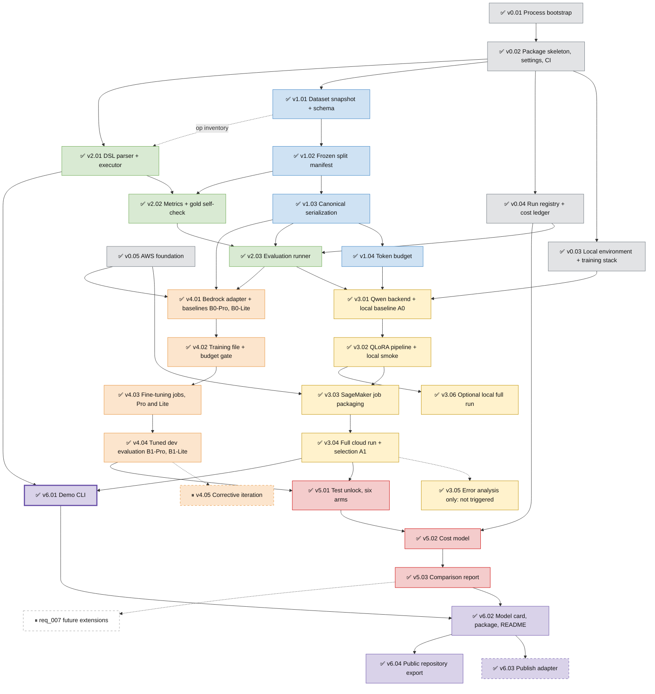

# Execution Plan — QLoRA Finetuning (FinQA: Qwen3-4B QLoRA vs Amazon Nova fine-tuning)

**Project**: `qlora_finetuning`  
**Created**: 2026-11-13  
**Last updated**: 2026-11-14 — plan revised before any version was specced: measured Qwen runs move to AWS SageMaker; the hosted path is Amazon Nova Pro **and** Nova Lite on Bedrock (OpenAI dropped); six arms; v0.05 and v3.03 added; Q1, Q5, Q6 resolved; six questions open (§9). Later the same day: §3 dependency graph coloured by spec group and badged with status (✅ / ▶ / ⏳ / ⏸); three edges that the tables already listed were added to it (v1.03 → v4.01, v0.04 → v5.02, v2.01 → v6.01).  
**Inputs**: `planning_material/openai_model_fine_tuning_qlora_project_guide.pdf` ("OpenAI guide"), `planning_material/Gemini FinQA QLoRA Fine-Tuning Execution Guide.pdf` ("Gemini guide"), `high_level_plan.md`, `../1. PROMPTS/coding.md`

This file turns the high-level plan into an ordered sequence of spec groups, versions, and
phases. It is a **planning and status document**: the per-group `req_NNN_roadmap.md` files
remain the single source of truth for each group's version sequence. When this file and a
roadmap disagree, trust the roadmap and fix this file.

**Arms** (six, all scored on the same frozen test set):

| Arm | Model | Tuned | Runs on |
|---|---|---|---|
| A0 | Qwen3-4B, 4-bit | No | SageMaker GPU job |
| A1 | Qwen3-4B, 4-bit + QLoRA adapter | Yes | SageMaker GPU job |
| B0-Pro | Amazon Nova Pro | No | Bedrock on-demand |
| B1-Pro | Amazon Nova Pro, fine-tuned | Yes | Bedrock on-demand (custom model) |
| B0-Lite | Amazon Nova Lite | No | Bedrock on-demand |
| B1-Lite | Amazon Nova Lite, fine-tuned | Yes | Bedrock on-demand (custom model) |

---

## 1. Spec groups

Spec groups live under `reqspecs/reqs/` and are created with
`/create-spec-group <folder_name> <feature_name>`. Version ids follow the template rule:
`req_NNN` → `v<N>.<NN>` with the leading zeros dropped from `N` (`req_000` → `v0.01`,
`req_003` → `v3.01`).

| # | Folder | Feature name | Owns | Guide § | Plan § |
|---|---|---|---|---|---|
| 0 | `req_000_project_scaffold` | `project_scaffold` | Process bootstrap (retarget inherited commands and templates, references skeleton, tracking folders), `qlora_finetuning/` package skeleton, `settings.py` + `config/`, CI, local development environment and pinned training stack, run registry and cost ledger, AWS foundation (S3, IAM roles, quotas, budget alarm) | OpenAI §2 A–B; Gemini Phase 1 | §4.5, §4.8, §5, §7 |
| 1 | `req_001_finqa_data` | `finqa_data` | Dataset snapshot and schema report, frozen 65/35 split manifest with dev slice and test lock, canonical prompt/target serialization, token budget report | OpenAI §1, §2 C–D; Gemini §2, Phase 2 | §4.1, §4.2, §4.3 |
| 2 | `req_002_dsl_evaluation` | `dsl_evaluation` | Arithmetic DSL parser and safe executor, metrics, `Predictor` protocol, resumable evaluation runner | OpenAI §4; Gemini Phase 3 step 1 | §4.4 |
| 3 | `req_003_qlora_local` | `qlora_local` | Path A: 4-bit Qwen3-4B inference backend, local baseline and smoke run, SageMaker job packaging, full cloud training run and checkpoint selection, one corrective iteration. *(Folder name predates the move to SageMaker; kept to avoid churn.)* | OpenAI §2 E–G, §3, §5; Gemini Phases 3–5 | §4.6, §4.8 |
| 4 | `req_004_frontier_tuning` | `frontier_tuning` | Path B: Bedrock adapter, zero-shot baselines, training-file export with cost estimate and budget gate, fine-tuning jobs, and tuned-model dev evaluation for Nova Pro and Nova Lite | — (not covered by the guides) | §4.7 |
| 5 | `req_005_comparison` | `comparison` | Single test unlock and evaluation of all six arms, cost model, statistics, comparison report | OpenAI §2 H, §4; Gemini Phase 6 step 1, §4 | §1, §4.4, §4.5 |
| 6 | `req_006_packaging_demo` | `packaging_demo` | Demo CLI, model card, adapter package, README | OpenAI §6; Gemini Phase 6 steps 2–3 | §2, §8 |
| 7 | `req_007_future_extensions` | `future_extensions` | ⏸ **Do not create until triggered.** Full-context or retrieval arm, Nova 2 Lite or other hosted models, other base models, sweeps, publishing the adapter | OpenAI §4 "evidence selection" | §2 out of scope |

Groups 0–6 were created on 2026-11-13 and regenerated with revised scopes on 2026-11-14 (no
version had been specced). Group 7 is listed only so its trigger is recorded.

---

## 2. Feature and roadmap placeholders per spec group

Each block is the seed written into the group's `req_NNN_roadmap.md`. Statuses are all
📋 Planned; the roadmap takes over tracking from here.

### req_000_project_scaffold

**Owns**: the repository skeleton, the development process scaffolding, the local development
environment, the cross-cutting run registry and cost ledger, and the shared AWS foundation.
Extends nothing; every other group depends on it.

| Version | Title | Scope summary | Depends on |
|---|---|---|---|
| v0.01 | Process bootstrap | Retarget the inherited command files and PRP templates (EDGAR/MCP/PyPI content listed in `docs/old_references/stale_project_name_references.md` §3) and rewrite their `uv run` commands for `venv` (Q6); remove the inherited PostgreSQL/FastAPI/alembic files (Q5); fix `coding.md` (plan path `reqspecs/0. PLANNING/`, module list, test rules for GPU/network/paid calls instead of DB); create `reqspecs/references/` skeleton with `common/gotchas.md` seeded from both guides; `track_progress/wip/`, `track_progress/roadmap_views/`; runbook stub sections; `.gitignore` covers `artifacts/` | — |
| v0.02 | Package skeleton, settings, CI | `qlora_finetuning/__init__.py` with `__version__`; `settings.py` (`get_str`/`get_int`, `load_config()` over versioned `config/*.yaml`); logging; sub-package stubs per plan §5; `tests/` mirror; pytest markers `gpu`, `network`, `paid`; `ruff`; minimal GitHub Actions workflow (CPU only, no model downloads) | v0.01 |
| v0.03 | Local development environment and training stack | `scripts/env_check.py`: GPU name, VRAM, driver, compute capability, BF16 support, CUDA build of torch; CUDA torch install kept out of `requirements.txt` (separate `requirements-train.txt` + runbook step); pin `torch`, `transformers`, `datasets`, `peft`, `trl`, `accelerate`, `bitsandbytes` (the same pins go into the cloud image in v3.03); **smoke gate**: load a small Qwen3 model in 4-bit NF4 and run one LoRA training step; native Windows vs WSL2 (Q3) | v0.02 |
| v0.04 | Run registry and cost ledger | `tracking/`: run ids, `artifacts/runs/<run_id>/` layout, run manifest (config snapshot, git commit, split-manifest hash); ledger records for wall-clock, billed instance-seconds with instance type, token counts, provider-billed amounts; append-only JSONL; summary reader | v0.02 |
| v0.05 | AWS foundation | us-east-1 for both paths; named AWS CLI profile; S3 bucket and prefix layout; least-privilege IAM execution roles for SageMaker and for Bedrock model customization; Service Quotas check and request for the SageMaker training instance; AWS Budgets alarm; read-only `scripts/aws_check.py`; runbook section. 🟡 The user creates credentials, roles, and the quota request | v0.02 |

### req_001_finqa_data

**Owns**: everything between the Hugging Face dataset and a model-ready example. Extends
`req_000_project_scaffold`; does not own scoring (`req_002_dsl_evaluation`) or path-specific
rendering (chat template in `req_003`, Bedrock JSONL in `req_004`).

| Version | Title | Scope summary | Depends on |
|---|---|---|---|
| v1.01 | Dataset snapshot and schema report | Download `bevaya/FinQA` (formerly `rootsautomation/FinQA`) at a pinned commit to `artifacts/data/finqa/`; checksums; schema and edge-case report: actual column names, program syntax, operation and `const_*` inventory, boolean answers, missing or empty fields, duplicates, examples per report | v0.02 |
| v1.02 | Frozen split manifest | Pool the official splits; 65/35 train/test grouped by report (Q4), seeded; carve dev (500) and quick-dev (200) out of train; commit manifest with seed, dataset revision, content hash; loaders take a split name; **test-lock guard** and its test; split statistics (program length and operation mix per split) | v1.01 |
| v1.03 | Canonical serialization | Markdown table formatter; gold-evidence selection from `gold_inds`; system/user/target record per plan §4.2; unit cues ("in millions", percentages) preserved; prompt template in `config/`; deterministic output, golden-file tests | v1.02 |
| v1.04 | Token budget report | Tokenize all fit + dev prompts with the Qwen3-4B tokenizer (CPU, tokenizer only); P50/P90/P98/P99 and maximum; share exceeding 1,536; policy for over-length examples (explicit, never silent truncation of the question or table); confirms or revises `max_seq_length`; total token volumes feed the Path B cost estimate | v1.03 |

### req_002_dsl_evaluation

**Owns**: the definition of "correct". Extends `req_001_finqa_data`; model-agnostic, imports
neither path.

| Version | Title | Scope summary | Depends on |
|---|---|---|---|
| v2.01 | DSL parser and safe executor | Strict two-field output parser; program tokenizer splitting on top-level commas; allowlisted operations (inventory from v1.01), `#k` references, `const_*`, table helpers given the example's table; typed errors for malformed syntax, bad references, division by zero; no `eval` | v0.02 *(inventory from v1.01)* |
| v2.02 | Metrics and gold self-check | Numeric normalization (commas, percent, scale, rounding), tolerance rule, yes/no for `greater`; execution accuracy, answer accuracy, program exact match, format validity; **gold self-check**: execute every gold program and compare with the gold answer, report and flag mismatches in the manifest | v2.01, v1.02 |
| v2.03 | Evaluation runner | `Predictor` protocol (prompt in; text, token counts, latency out); runner over a named split; resumable predictions JSONL with raw output, parsed program, executed value, per-example scores; writes to the run registry and cost ledger; a fake predictor for tests | v2.02, v1.03, v0.04 |

### req_003_qlora_local

**Owns**: Path A, the Qwen3-4B QLoRA path, up to a selected adapter evaluated on dev. Developed
and smoke-tested on the local GPU; every reported number comes from SageMaker. Extends `req_001`
and `req_002`; does not own the test evaluation or the report (`req_005`).

| Version | Title | Scope summary | Depends on |
|---|---|---|---|
| v3.01 | Qwen backend and zero-shot baseline | `Predictor` for 4-bit NF4 Qwen3-4B: chat template with `enable_thinking=False`, greedy decoding, `max_new_tokens=192`, stop handling, optional adapter path; **arm A0 on quick-dev, local GPU** (development evidence) | v2.03, v1.04, v0.03 |
| v3.02 | QLoRA training pipeline | Training entry point driven by `config/` (plan §4.6 defaults); chat-template rendering of fit and dev; completion-only loss verified against the installed TRL; checkpointing; ledger hooks; **local smoke run** on about 64 examples that shows loss falling and an adapter reloading | v3.01 |
| v3.03 | SageMaker job packaging | Train and evaluate entry points that run unchanged locally and as SageMaker training jobs; training image or framework container with the v0.03 pins; launcher: upload split-filtered data to S3, start the job, stream logs, pull results and billable seconds into the registry and ledger; checkpoints to S3; maximum-runtime stop; dry-run mode; 🟡 a short paid smoke job proves the round trip (Q8, Q9) | v3.02, v0.05 |
| v3.04 | Full training run and checkpoint selection | 🟡 Full fit run on SageMaker (2–3 epochs), started by the user after the smoke job gives a time and cost estimate; dev execution accuracy per checkpoint; select the best; **arm A1 on dev, in the cloud**; billable seconds and instance type in the ledger; adapter and metadata to S3 and pulled locally | v3.03 |
| v3.05 | ⏸ Error analysis and one corrective iteration | Categorize dev failures (format, sign/order, scale/unit, wrong evidence); change one variable; rerun. **Trigger**: dev execution accuracy or format validity below the thresholds set in the v3.04 spec | v3.04 |
| v3.06 | Full local training run (optional) | The owner's learning exercise: the full fit run on the laptop GPU with the same config as the cloud run; dev execution accuracy per checkpoint; wall-clock time and peak VRAM recorded. Runs after v3.02 and before v3.03, blocks nothing, and is a side note, not an arm | v3.02 |

### req_004_frontier_tuning

**Owns**: Path B, Amazon Nova Pro and Nova Lite fine-tuned through Bedrock, up to two tuned
models evaluated on dev. Extends `req_001` and `req_002`; does not own the test evaluation or
the report (`req_005`). Paid steps are 🟡 operator-gated.

| Version | Title | Scope summary | Depends on |
|---|---|---|---|
| v4.01 | Bedrock Nova adapter and zero-shot baselines | Record availability, limits, and prices for both models checked on the day; `FrontierProvider` interface and a Bedrock implementation (Converse API), model id from config; inference `Predictor` with fixed, recorded settings; retry and throttling handling; **arms B0-Pro and B0-Lite on quick-dev**; tests against a mocked client | v2.03, v1.03, v0.05 |
| v4.02 | Training file export and budget gate | Render fit and dev once to Bedrock conversation JSONL (`bedrock-conversation-2024`), shared by both models; upload to S3; validate; count tokens; estimate training and evaluation cost per model from `config/` pricing (with price-list date); refuse above the budget cap (Q2); dry-run report; guard: zero test ids | v4.01 |
| v4.03 | Fine-tuning jobs | ✅ One Bedrock model-customization job per model with recorded hyperparameters (`epochCount`, `learningRate`, `learningRateWarmupSteps`); poll; on-demand deployment of each custom model; job and model ARNs, billed tokens and amounts into the ledger; resumable; runbook entry including teardown. **Never Provisioned Throughput** | v4.02 |
| v4.04 | Tuned-model dev evaluation | **Arms B1-Pro and B1-Lite on dev**; each compared with its B0; cost per example recorded | v4.03 |
| v4.05 | ⏸ One corrective iteration | For a model that missed, change one job setting (epoch count or learning rate) and rerun. **Trigger**: a B1 dev result below its v4.04 threshold, and budget remaining | v4.04 |

### req_005_comparison

**Owns**: the answer to the project's question. Extends `req_003` and `req_004`; the only group
allowed to read the test split.

| Version | Title | Scope summary | Depends on |
|---|---|---|---|
| v5.01 | Test unlock and six-arm evaluation | Freeze all configurations in a signed-off record; unlock test once; run A0 and A1 as SageMaker evaluation jobs and the four Nova arms through Bedrock, all with the same runner; predictions and ledger entries stored; no configuration changes afterwards | v3.04 *(or v3.05)*, v4.04 *(or v4.05)* |
| v5.02 | Cost model | Per model, from the ledger: billed instance-seconds × instance rate (Qwen), billed tokens × token price plus storage (Nova); training cost, cost per 1,000 questions, break-even volumes; sensitivity to Path A utilization | v5.01, v0.04 |
| v5.03 | Comparison report | `reports/`: six-arm metric table with bootstrap confidence intervals and McNemar tests, cost table, accuracy-versus-cost chart, error categories with examples, oracle-evidence caveat, deviations log; summary in README | v5.02 |

### req_006_packaging_demo

**Owns**: the hand-off artifacts. Extends `req_003` and `req_005`.

| Version | Title | Scope summary | Depends on |
|---|---|---|---|
| v6.01 | Demo CLI | `python -m qlora_finetuning.demo`: context, table, and question in; proposed program, safely executed result, and model answer out; loads the selected adapter (pulled from S3) on the local GPU; one bundled sample input | v3.04, v2.01 |
| v6.02 | Model card, adapter package, README | Adapter weights, a merged copy (owner's decision, 2026-11-23), tokenizer details, base model id, prompt template, training metadata; model card with data source, evaluation results, limitations, licenses, FinQA citation; README with setup, reproduction steps, and results | v5.03, v6.01 |
| v6.03 | ⏸ Publish adapter | Push the adapter and card to the Hugging Face Hub. **Trigger**: the user decides to publish; 🟡 operator-gated | v6.02 |
| v6.04 | Public repository export | Added 2026-11-24 (owner's decision to publish the code). A copy of the repository for a public one on GitHub, without history: built from a commit by one command, with the AWS account number replaced by a placeholder, the runbook as `docs/runbook.md`, a notice that it is a redacted snapshot, and checks that nothing private remains and that the copy's own tests pass; 🟡 the push and making it public are the owner's | v6.02 |

### req_007_future_extensions (⏸ not created)

**Owns**: scope explicitly excluded from the first comparison. **Trigger**: the v5.03 report is
complete and the user accepts a follow-up. Candidates: full-context or retrieval-based arm,
few-shot hosted arms, Nova 2 Lite or Nova Micro arms, `Qwen3-1.7B` or `Qwen3-8B` arms, LoRA rank
or sequence-length sweeps, a hosted endpoint for the adapter, merged-weights export. Each needs
its own spec.

---

## 3. Dependency graph

**Legend.** Node colour = spec group: grey req_000 project scaffold, blue req_001 FinQA data,
green req_002 DSL evaluation, yellow req_003 QLoRA (Path A), orange req_004 frontier tuning
(Path B), red req_005 comparison, purple req_006 packaging and demo, white req_007 future
extensions. Dashed border and unlabelled dotted edge = conditional version (⏸). The one labelled
dotted edge (`op inventory`, v1.01 → v2.01) is a soft input, not a condition: v2.01 can start
after v0.02 and takes its operation list from v1.01 when that exists.
Badge in the label = status: ✅ complete; ▶ unblocked (every predecessor ✅, can start now; also a
thick border); ⏳ blocked on a predecessor; ⏸ conditional. **Upkeep**: whenever a §8 status board
row changes (a version completes or is shelved), update the badge of that node and of every node
it unblocks, plus the `ready` class line and the "Last badge update" comment, in the same edit.

**Text form.** After v0.02 four strands run in parallel (local environment v0.03, ledger v0.04,
AWS foundation v0.05, data v1.x), and the DSL executor v2.01 needs only the package skeleton
plus the operation inventory from v1.01. The strands meet at the evaluation runner v2.03. From
there **Path A (v3.x) and Path B (v4.x) are independent** and meet again at the test unlock
v5.01. Dotted edges are conditional.

Suggested single-worker order (one version at a time):

`v0.01 → v0.02 → v0.05 → v0.03 → v1.01 → v1.02 → v2.01 → v1.03 → v2.02 → v0.04 → v1.04 → v2.03 → v3.01 → v4.01 → v3.02 → v4.02 → v3.03 → v4.03 → v3.04 → v4.04 → v5.01 → v5.02 → v5.03 → v6.01 → v6.02`

Notes on that order:

- **v0.05 moves up front** because the SageMaker GPU quota request can take days and nothing
  else can shorten it. The user-side steps (credentials, quota request) can start even before
  v0.02 lands. Done 2026-11-14: the resources exist and the quota was already in place, and the
  code part was built the same day, ahead of v0.02 at the owner's request (self-contained; v0.02
  swaps its stand-in config loader for `load_config()`).
- v0.03 stays early: it proves the library pins that the cloud image will reuse.
- The Bedrock jobs (v4.03) and the SageMaker run (v3.04) both execute in AWS, so they can
  overlap in wall-clock time.
- **v3.06 is optional and not in the order above.** If the owner runs it, it goes between v3.02
  and v3.03, so the full pipeline is exercised on the laptop before the first billed job.
- No open question blocks the start. Q2 (budget cap) is resolved; Q8 and Q9 are needed by v3.03.

**Dependency summary** (the roadmaps remain authoritative):

| Version | Depends on | Status | Note |
|---|---|---|---|
| v0.01 | — | ✅ | Q5, Q6 resolved; built 2026-11-14; M0 reached |
| v0.02 | v0.01 | ✅ | Built 2026-11-14; 120 tests, lint clean; live `aws_check` 7/7; CI green on pull request #1 and on `main` (2026-11-15) |
| v0.03 | v0.02 | ✅ | Built 2026-11-15; `env_check --smoke` 7/7 on native Windows; M1 reached; Q3 resolved; CI green on pull request #2 and on `main` (2026-11-15) |
| v0.04 | v0.02 | ✅ | Built 2026-11-15; CI green on pull request #2 and on `main` (2026-11-15); P0 done |
| v0.05 | — | ✅ | Built 2026-11-14 ahead of v0.02 (self-contained, so it depends on nothing); `aws_check` 7/7; M1b reached; v0.02 swaps the stand-in config loader |
| v1.01 | v0.02 | ✅ | Built 2026-11-15; snapshot fetched and verified, report checks S1–S10 pass on 8,281 examples; dataset is now `bevaya/FinQA` (the old name redirects); CI green on pull request #2 and on `main` (2026-11-15) |
| v1.02 | v1.01 | ✅ | Built 2026-11-15; Q4 resolved as company; fit 4,884 / dev 499 / test 2,898; checks P1–P10 pass; M2 reached; CI green on pull request #3 and on `main` (2026-11-15) |
| v1.03 | v1.02 | ✅ | Built 2026-11-15; 4,884 fit and 499 dev records, checks C1–C10 pass; prompt id `d63742a62b76...`; wording still open to change until the first baseline; CI green on pull request #3 and on `main` (2026-11-15) |
| v1.04 | v1.03 | ✅ | Built 2026-11-15; checks T1–T6 pass; training length 2,048, reply limit 192; one pass over fit is 3,254,181 tokens; CI green on pull request #3 and on `main` (2026-11-15); P1 complete |
| v2.01 | v0.02 (+ v1.01 inventory) | ✅ | Built 2026-11-15; all 5,383 fit and dev gold programs parse and execute, every result equal to the gold one at five decimal places or within a relative 0.0005%; 1,045 tests and lint green locally (the owner's run). First version completed without a pull request |
| v2.02 | v2.01, v1.02 | ✅ | Built 2026-11-16; the owner chose 0.5% for execution accuracy; all 8,281 gold programs reproduce their gold answer, none flagged; 1,237 tests and lint green locally |
| v2.03 | v2.02, v1.03, v0.04 | ✅ | Built 2026-11-16; the gold predictor scores 200 of 200 on quick-dev and 499 of 499 on dev through the runner, checks R1–R5 pass; 1,392 tests and lint green locally; marked complete by the owner. P2 done; M3 reached |
| v3.01 | v2.03, v1.04, v0.03 | ✅ | Built and run 2026-11-19 (commit pending): A0 on this machine, execution accuracy 0.50% on quick-dev and 0.60% on dev; weights 2.42 GiB, 4.1 s per example at batch size 1; batch size 8 changed 16 of 40 replies, so the batch size for the cloud runs is the owner's to decide by v3.03. M4 reached. Nothing billed |
| v3.02 | v3.01 | ✅ | Built and run 2026-11-19 (commit pending): the training pipeline, `qlora_train`, and `qwen3-4b-tuned --adapter`; the smoke run passes K1 to K7 (worst batch 11.00 GiB of 16; loss 2.27 to 0.28; 24 of 24 programs run). The full plan is 918 steps, 10 checkpoints. No full run yet |
| v3.03 | v3.02, v0.05 | ✅ | Code built and rehearsed 2026-11-19. Smoke job 2026-11-20: the first failed before its first step (281 billable seconds, $0.11; the container's torchvision and torchaudio, now removed by the bootstrap script); the second, `qlora-smoke-6f2dd19d-a1`, ended `Completed` in 792 billable seconds, $0.31, and was pulled. K1 to K7 pass in the job; versions equal the pins; 1.115 s per training sequence on the A10G. Path A at $0.42 of its $100 cap. Q8, Q9 closed; batch size 8 |
| v3.04 | v3.03 | ✅ | Jobs run 2026-11-20 and 2026-11-21, both on their first attempt: training 15,037 billable seconds ($5.88), scoring 4,965 ($1.94). **Arm A1 is checkpoint 500: 358 of 499 right on dev (71.74%), every reply in the format; verdict `met`.** A0 in the same job 6 of 499. Selection record committed; adapter kept in the bucket. Path A at $8.24 of its $100 cap. **M5 reached** |
| v3.05 | v3.04 | ✅ | Ended 2026-11-21 as analysis only: the verdict is `met`, so the iteration was not triggered and nothing was billed. Error analysis of A1 on dev written: the 141 wrong replies are all in the format; 65 have fewer steps than the gold program; three-step questions 7 of 35 right. Finding T3. Report commit pending |
| v3.06 | v3.02 | ✅ | Run made 2026-11-20 by the owner: 2.87 hours of training on the laptop, nothing billed and no AWS. Checkpoint 900 has 360 of 499 right on dev (72.14%). A side note, not an arm. `qlora_local note` was run once more on 2026-11-21, after v3.04's selection: the local run is 2 examples above the cloud's arm A1 on dev (360 against 358), within noise. Blocks nothing |
| v4.01 | v2.03, v1.03, v0.05 | ✅ | Complete 2026-11-18: the owner's four baseline runs ($0.49) and the baseline report. Dev execution accuracy B0-Pro 38.08%, B0-Lite 24.65%; Nova to Qwen token ratio 0.985. arms B0-Pro, B0-Lite; M4 with v3.01 |
| v4.02 | v4.01 | ✅ | Complete 2026-11-18: gate open (measured ratio 0.9851; Path B estimate $82.46 of the $200 cap; training $64.11 for both models at 2 epochs) and both files staged in S3 by the owner |
| v4.03 | v4.02 | ✅ | Complete 2026-11-22: both jobs ran (default hyperparameters, 2 epochs) and both tuned models are deployed on-demand and Active. Nova Lite billed $14.60 (estimate $12.82); Nova Pro's charge not on the bill yet (estimate $51.29) |
| v4.04 | v4.03 | ✅ | Complete 2026-11-22: dev execution accuracy B1-Pro 71.94% (359 of 499, +33.87 points), B1-Lite 65.93% (329 of 499, +41.28 points); every reply well-formed; both met the threshold; the four runs cost $0.45; M6 |
| v4.05 | v4.04 | ⏸ | trigger did not fire: both models met their threshold on 2026-11-22 |
| v5.01 | v3.04/v3.05, v4.04/v4.05 | ✅ | Complete 2026-11-23: frozen, unlocked, six arms run once on the 2,898 test examples, six-arm record passes C1 to C8, no run voided; M7. Counts, execution accuracy on the 2,898 test examples: A0 27 (0.93%), A1 2,121 (73.19%), B0-Lite 484 (16.70%), B1-Lite 2,069 (71.39%), B0-Pro 1,025 (35.37%), B1-Pro 2,179 (75.19%) |
| v5.02 | v5.01, v0.04 | ✅ | Complete 2026-11-24: code built 2026-11-23; the owner entered the bill on 2026-11-24 (Bedrock $81.98, SageMaker $10.87, equal to the model to the cent); K1 to K8 pass with no reservation. Path A $10.87 of $100, Path B $78.08 of $200 ($81.98 with storage) |
| v5.03 | v5.02 | ✅ | Complete 2026-11-24: `reports/comparison_report.md` committed (`3dbf2b2`), R1 to R8 pass with no reservation; **M8**. Tuning gains 39.82 to 72.26 points; tuned Nova Pro ahead of A1 by 2.00 points (settled); A1 ahead of tuned Nova Lite by 1.79 (not settled); A1 the cheapest of the three to make and cheaper per question than tuned Nova Pro |
| v6.01 | v3.04, v2.01 | ✅ | Built and verified 2026-11-23: `python -m qlora_finetuning.demo` answers the invented sample with the selected adapter on the local GPU (program runs, executed value as expected, the model's answer agrees); nothing billed, no AWS call |
| v6.02 | v5.03, v6.01 | ✅ | Built and verified 2026-11-24: the adapter package and the merged copy are ready under `artifacts/release/`, checks P1 to P10 pass (the package gives the adapter's 499 dev replies; the merged copy has 361 and 357 right against 358), both cards and the package record are in `reports/packaging/`, README rewritten. Nothing uploaded, nothing billed. M9 reached |
| v6.03 | v6.02 | ✅ | Complete 2026-11-25: both models are public on the Hugging Face Hub and the final check passed without a token. The trigger fired on 2026-11-24; built and tested the same day: `scripts.hf_publish` uploads the two packages to private repositories after comparing every file with the package record, and checks the Hub against it (U1 to U7). The uploads and making the repositories public are the owner's |
| v6.04 | v6.02 | ✅ | Complete 2026-11-24, the repository is public. Built and checked: `scripts.public_export` writes the public folder from a commit, with the account number replaced and a snapshot notice; checks E1 to E10; five freeze tests skipped in a copy by a marker. The owner commits there, pushes, and makes the repository public. Recommended before v6.03 |
| req_007 | v5.03 | ⏸ | trigger: accepted follow-up |

---

## 4. Logical phases

| Phase | Name | Versions | Exit criterion |
|---|---|---|---|
| **P0** | Bootstrap | v0.01 – v0.05 | Commands and templates describe this project; `pytest -q` and `ruff check .` pass on the wired package; `scripts/env_check.py` passes including the 4-bit load and one training step; a dummy run writes a registry entry and ledger records; `scripts/aws_check.py` passes (bucket, roles, quota, budget alarm) |
| **P1** | Data | v1.01 – v1.04 | Split manifest committed with its hash; test-lock guard test green; serialization golden files stable; token budget report confirms the sequence length or revises it |
| **P2** | Evaluation harness | v2.01 – v2.03 | Gold self-check rate reported and accepted; runner produces a complete scored predictions file from the fake predictor on dev |
| **P3** | Path A: Qwen QLoRA | v3.01 – v3.04 (v3.05; optional v3.06) | Arms A0 and A1 scored on dev by the shared runner; adapter and metadata saved; SageMaker billed time in the ledger |
| **P4** | Path B: Nova on Bedrock | v4.01 – v4.04 (v4.05) | Arms B0 and B1 scored on dev for both Nova Pro and Nova Lite; custom model ARNs and billed cost in the ledger |
| **P5** | Comparison | v5.01 – v5.03 | Six arms scored once on the test split; report committed under `reports/` |
| **P6** | Packaging and demo | v6.01 – v6.02 | Demo answers the bundled sample; model card and README complete |
| **P7** | Conditional | v3.05, v4.05, v6.03, req_007 | Each item starts only when its trigger fires |

P1 and P2 overlap; P3 and P4 overlap.

---

## 5. Detailed listing and coverage per phase

### P0 — Bootstrap

**Delivers**

- Command files (`generate-prp`, `execute-prp`, `release-tag`, `wip-roll`, `roadmap_view-roll`)
  and PRP templates free of EDGAR / MCP / PyPI / Registry content and using `venv`.
- Inherited database stack removed (`alembic.ini`, `alembic/`, SQLAlchemy/psycopg/FastAPI pins,
  `DATABASE_URL`, the `db` pytest marker).
- `coding.md` corrected: plan path, module list from plan §5, test rules for GPU, network, and
  paid calls.
- `reqspecs/references/` skeleton; `common/gotchas.md` seeded from the guides (thinking mode
  on by default in Qwen3, silent truncation, completion-only loss API drift, BF16 vs FP16,
  bitsandbytes on Windows, `max_new_tokens` truncating programs, never tune against test) and
  from this plan (Provisioned Throughput cost trap, GPU quota lead time).
- `qlora_finetuning/` package, `settings.py`, `config/`, logging, `tests/` mirror, CI.
- `scripts/env_check.py`, `requirements-train.txt`, pinned versions, runbook install steps.
- `tracking/` run registry and cost ledger.
- AWS foundation: profile, bucket, roles, quota, budget alarm, `scripts/aws_check.py`.

**Covers**: coding.md "Project Awareness", "Code Structure", "Testing"; OpenAI guide §2 A–B and
"A useful first hardware check"; Gemini guide Phase 1; plan §4.5, §4.8, §5.

**Proves**

| Check | Version |
|---|---|
| No stale-reference grep hits (command in `stale_project_name_references.md` §5, extended with EDGAR/MCP/`uv run`/alembic terms) | v0.01 |
| `pytest -q` and `ruff check .` pass; CI green without GPU, network, or keys | v0.02 |
| `load_config()` returns typed values from versioned YAML; missing key fails loudly | v0.02 |
| `env_check` reports GPU, driver, VRAM, compute capability ≥ 8.0, BF16 available, torch CUDA build | v0.03 |
| 4-bit NF4 load of a small Qwen3 model plus one LoRA optimizer step succeeds (`@pytest.mark.gpu`) | v0.03 |
| Ledger append and summary round-trip; run manifest captures git commit and config snapshot | v0.04 |
| `aws_check`: caller identity, bucket reachable and private, both roles assumable by their services, training-instance quota ≥ 1, budget alarm present, Nova Pro and Nova Lite listed as fine-tunable for the account | v0.05 |

### P1 — Data

**Delivers**: dataset snapshot, schema report, committed split manifest, canonical serializer,
prompt template in `config/`, token budget report.

**Covers**: OpenAI guide §1, §2 C–D, §5 "long report context" and "benchmark leakage"; Gemini
guide §2 and Phase 2; plan §4.1–§4.3; the brief's 65% rule and shared-split rule.

**Proves**

| Check | Version |
|---|---|
| Example count is 8,281 at the pinned revision; column names recorded from the actual data | v1.01 |
| Operation and constant inventory extracted from all gold programs | v1.01 |
| Train share is 65% within the tolerance that grouping allows; no report appears on both sides | v1.02 |
| Re-running the splitter reproduces the committed manifest byte for byte | v1.02 |
| Loading `test` without the unlock raises; dev and quick-dev are subsets of train | v1.02 |
| Markdown table keeps headers aligned with cells; ragged and empty cells handled | v1.03 |
| Same example always serializes to the same text (golden files) | v1.03 |
| Target string round-trips through the v2.01 parser | v1.03 / v2.01 |
| Token percentiles reported; over-length examples listed with the applied policy | v1.04 |

### P2 — Evaluation harness

**Delivers**: `dsl/` parser and executor, `evaluation/` metrics and runner, fake predictor.

**Covers**: OpenAI guide §4 (all five metrics; evidence selection stays optional), §5 "wrong
arithmetic"; Gemini guide Phase 3 step 1; plan §4.4.

**Proves**

| Check | Version |
|---|---|
| Each allowed operation, `#k` chaining, and `const_*` literal evaluates correctly | v2.01 |
| Unknown function, forward reference, wrong arity, division by zero → typed errors, never exceptions leaking | v2.01 |
| Hostile input (nested calls, attribute access, very long strings) is rejected without evaluation | v2.01 |
| Table helpers read the right row of the example's table | v2.01 |
| Percent, comma, and scale normalization; tolerance boundary cases; yes/no for `greater` | v2.02 |
| Gold self-check rate over all 8,281 examples reported; mismatches listed | v2.02 |
| Runner resumes after interruption without duplicating or skipping examples | v2.03 |
| Runner on the fake predictor yields the expected aggregate metrics | v2.03 |

### P3 — Path A: Qwen QLoRA

**Delivers**: Qwen backend, local baseline, training pipeline, SageMaker launcher, selected
adapter, dev result A1 from the cloud.

**Covers**: OpenAI guide §2 E–G, §3, §5; Gemini guide §1 adjustments, Phases 3–5; plan §4.6,
§4.8.

**Proves**

| Check | Version |
|---|---|
| Rendered prompt has thinking off and no reply holds a thinking block; generation ends at the model's end token or the reply limit (reworded 2026-11-18 from "stops after the `ANSWER` line": no arm gets a stop string) | v3.01 |
| A0 metrics on quick-dev recorded locally with peak VRAM and seconds per example | v3.01 |
| Labels are masked everywhere except the assistant completion (unit test on tokenized batch) | v3.02 |
| Local smoke run: loss decreases; saved adapter reloads and generates | v3.02 |
| Launcher dry run prints the job definition; uploaded S3 objects contain fit and dev ids only | v3.03 |
| Cloud smoke job completes; outputs and billable seconds land in the registry and ledger; library versions in the job log equal the local pins | v3.03 |
| Full run completes; per-checkpoint dev execution accuracy logged | v3.04 |
| Selected checkpoint is the dev-accuracy maximum, not the loss minimum; A1 beats A0 on dev | v3.04 |

### P4 — Path B: Nova on Bedrock

**Delivers**: Bedrock adapter, baselines, validated training file, two tuned models, dev results.

**Covers**: the brief's second path; plan §4.7. Not covered by either guide, so the v4.01 spec
is written from current AWS documentation.

**Proves**

| Check | Version |
|---|---|
| Adapter tests pass against a mocked client; no test needs credentials | v4.01 |
| Prompts sent to Bedrock are byte-identical to the canonical records | v4.01 |
| B0-Pro and B0-Lite metrics on quick-dev recorded with token counts and cost | v4.01 |
| JSONL passes format validation; training file contains fit only, validation file dev only, **zero test ids** | v4.02 |
| Per-model cost estimate printed; run refuses above the budget cap | v4.02 |
| For each model: job ARN, custom model ARN, billed tokens and amount recorded; deployment is on-demand; no Provisioned Throughput exists in the account | v4.03 |
| B1-Pro and B1-Lite metrics on dev recorded; each compared with its B0 | v4.04 |

### P5 — Comparison

**Delivers**: test predictions for six arms, cost model, committed report.

**Covers**: OpenAI guide §2 H, §4 "evaluate once on test", §6 evaluation table and error set;
Gemini guide Phase 6 step 1; the brief's "compare the cost and accuracy".

**Proves**

| Check | Version |
|---|---|
| Configuration freeze record exists and predates the unlock | v5.01 |
| All six arms have a prediction for every test id; same prompts across arms | v5.01 |
| Cost figures reproduce from the ledger and `config/` rates with one command; they reconcile with the AWS bill within a stated margin | v5.02 |
| Report tables regenerate from stored predictions; confidence intervals and paired tests present | v5.03 |

### P6 — Packaging and demo

**Delivers**: demo CLI, model card, adapter package, README.

**Covers**: OpenAI guide §6 deliverables; Gemini guide Phase 6 steps 2–3; plan §8.

**Proves**: demo returns the expected program and executed value for the bundled sample; model
card lists licenses, citation, limitations, and the oracle-evidence caveat; README steps
reproduce the environment on a clean checkout; runbook teardown leaves no billable AWS resource
except what the user chose to keep.

### P7 — Conditional

**Delivers**: nothing until triggered. Keeps v3.05, v4.05, v6.03, and req_007 visible.

---

## 6. Milestones

| # | Milestone | Reached when | Phase |
|---|---|---|---|
| M0 | Process ready | Seven spec groups exist with roadmaps; commands and PRP templates retargeted; first PRP can be generated | P0 |
| M1 | Local environment verified | `env_check` passes with the 4-bit load and one training step on this machine | P0 |
| M1b | AWS ready | `aws_check` passes: bucket, roles, GPU training quota, budget alarm, Nova models available | P0 |
| M2 | Split frozen | Manifest committed; hash recorded here; test-lock guard green | P1 |
| M3 | Harness trusted | Gold self-check accepted; runner end-to-end on the fake predictor | P2 |
| M4 | Baselines recorded | A0, B0-Pro, and B0-Lite scored on quick-dev | P3, P4 |
| M5 | QLoRA adapter selected | A1 scored on dev from the SageMaker run; adapter saved | P3 |
| M6 | Nova models tuned | B1-Pro and B1-Lite scored on dev; custom model ARNs recorded | P4 |
| M7 | Test unlocked | Six arms scored once on the test split | P5 |
| M8 | Comparison published | Report committed under `reports/` | P5 |
| M9 | Deliverables packaged | Demo, model card, README complete | P6 |

---

## 7. Working agreements

1. **Spec first.** No code is written for a version until its `req_NNN_NN_spec.md` exists with
   status 📝 Spec ready and its decisions locked.
2. **One PRP per version.** `/generate-prp reqspecs/reqs/req_NNN_<feature> --version N`
   produces exactly one PRP; `/execute-prp` runs exactly one. A version that needs two PRPs is
   split first.
3. **Roadmap upkeep in the same turn.** Any status change updates the group's quick-reference
   table, detail section, version log, and "Last updated" line immediately; this file's status
   board (§8) is updated at the same time.
4. **Follow the graph.** Work follows §3. Nothing conditional starts before its trigger; no
   scope widening without a roadmap entry.
5. **The split is frozen.** After M2 the manifest changes only by an explicit decision recorded
   in the `req_001` roadmap, and any such change invalidates all earlier results.
6. **The test split is read once.** Only `req_005` v5.01 loads test rows or uploads them to S3.
   Baselines, checkpoint selection, prompt changes, and Bedrock validation use dev.
   *Amended 2026-11-23 (the owner's decision, `req_005_03_spec.md` decision 9)*: v5.03 also
   reads test rows, on the owner's machine only, to score and categorize the stored replies
   of the six test runs. No model answers a test question, nothing is uploaded, and no
   frozen file changes.
7. **Same contract for every arm.** Prompt wording, output format, and scorer are shared. A
   change to any of them applies to all models and reruns them.
8. **One variable at a time.** After the first stable run on either path, change a single
   setting per iteration and record why.
9. **Tests need no GPU, network, or credentials.** Such checks sit behind `@pytest.mark.gpu`,
   `network`, or `paid` and skip by default. `ruff check .` and `pytest -q` pass before a task
   is reported done.
10. **Anything billed is operator-gated.** Claude prepares, estimates, and verifies; the user
    creates AWS credentials, roles, and quota requests, and starts every SageMaker job and
    Bedrock customization job after seeing its estimate.
11. **Reported numbers come from the cloud.** The local GPU is for development and smoke tests;
    no local run appears in the comparison.
12. **No Provisioned Throughput, no idle resources.** Custom Nova models are deployed on-demand.
    SageMaker work runs as jobs with a maximum runtime, never as an always-on instance. Each
    paid version's runbook entry includes teardown.
13. **No tunable numbers in code.** Hyperparameters, tolerances, seeds, instance types, and
    prices live in versioned YAML under `config/`; each run snapshots its config.
14. **Everything is logged.** Every training and evaluation run writes a registry entry and
    ledger records; raw prompts, raw outputs, parsed programs, and per-example scores are kept.
15. **Secrets stay out of the repo.** AWS credentials live in the AWS CLI profile, other secrets
    in `.env`; neither is committed or written to logs or the ledger.
16. **Branch per version, PR to `main`.**
17. **Daily tracking.** `/wip-roll` records session progress; `/roadmap_view-roll` snapshots the
    backlog.
18. **Verify external facts when speccing.** Library APIs, model and dataset cards, Bedrock
    fine-tuning availability and limits, and prices change; each spec that depends on one
    records what was checked and when.

---

## 8. Status board

Status glyphs follow the roadmap legend: ⏸ Conditional · 📋 Planned · 📝 Spec ready · 🛠 PRP ready · 🚧 In flight · 🟡 Operator-gated · ✅ Complete · 🗄 Shelved.

**Board last updated**: 2026-11-14 — planning revised. 2026-11-13: `high_level_plan.md` expanded, this plan written, `architecture/architecture_overview.md` v0.1 drafted, spec groups req_000–req_006 created; Q5 and Q6 resolved (remove the inherited database stack; keep `venv`); OpenAI researched and dropped (self-serve fine-tuning closed to new users, ends 2027-01-06). 2026-11-14: hosted path set to Amazon Nova Pro and Nova Lite on Bedrock (Q1 resolved, six arms); measured Qwen runs moved to SageMaker; v0.05 "AWS foundation" and v3.03 "SageMaker job packaging" added (former v3.03/v3.04 are now v3.04/v3.05); roadmaps regenerated; architecture v0.2. Later on 2026-11-14: the user created the AWS resources for v0.05 (profile `qlora`, bucket, two roles, $300 budget alarm) and Claude verified them; GPU quota and Nova fine-tuning access were already in place; Q2 resolved; `req_000_05_spec.md` written (📝). v3.06 "Full local training run" added to req_003 as an optional learning exercise (after v3.02, before v3.03; a side note, not an arm). v0.01–v0.04 are not specced. Later again: v0.05 PRP written and executed ahead of v0.02 at the owner's request (`config/aws.yaml`, `scripts/aws_check.py`, tests, runbook AWS section); `aws_check` passes 7/7, so M1b is reached. v0.05's dependency on v0.02 removed (built self-contained). `req_000_01_spec.md` drafted for v0.01 (📝). v0.01 PRP written and executed the same day: M0 reached. `req_000_02_spec.md` drafted and the v0.02 PRP executed the same day (🟡): one owner step remains: open the pull request so CI runs (the live `aws_check` run passed 7/7 after the owner signed in again). The package exists, so v0.03, v0.04, v1.01, and v2.01 can be specced. 2026-11-15: pull request #1 merged to `main`; CI passed on the pull request and on `main`, so v0.02 is ✅; `lint and test` made a required check in `protect-main`; `req_000_03_spec.md` drafted and the v0.03 PRP executed (🟡): the pinned training stack installs and `env_check --smoke` passes 7/7 on native Windows, so M1 is reached and Q3 is resolved; the CI run on the pull request is the one remaining item. `req_000_04_spec.md` drafted and the v0.04 PRP executed (🟡): run registry, cost ledger, and summary script built, 286 tests pass. req_000 is now fully built; v0.03 and v0.04 wait only for CI on the pull request, which the owner will open after a few more versions. `req_001_01_spec.md` drafted for v1.01 (📝) after downloading and profiling the dataset: the repository is now `bevaya/FinQA` (`rootsautomation/FinQA` redirects), pinned by commit and checksums; 8,281 rows, ten operations as planned, plus percent literals as program arguments. The v1.01 PRP was written and executed the same day (🟡): the snapshot is fetched and verified, `load_raw_examples()` returns the 8,281 records, and the committed schema report passes checks S1–S10; 386 tests pass; the CI run on the pull request is the one remaining item (`pyarrow` was added to `requirements.txt`). Next: the v1.02 spec (Q4 can now be decided from the report's group sizes) or the v2.01 spec (its operation inventory exists). Later on 2026-11-15: release v1.1 was cut and pull request #2 merged to `main`; CI passed on the pull request and on `main` (385 passed, 1 skipped), so v0.03, v0.04, and v1.01 are ✅ and phase P0 is done. `req_001_02_spec.md` drafted for v1.02 (📝): the split is proposed by company, not by report, after measuring that report grouping leaks numbers between years (Q4 awaits the owner); fit 4,884 / dev 499 / test 2,898. The owner proceeded to the PRP, which resolves Q4 as company. The v1.02 PRP was written and executed the same day (🟡): the split manifest was written once (content hash `d34fb22e37b7...`), checks P1–P10 pass, `load_split` serves `fit`, `dev`, and `quick_dev`, and the test split is locked; 495 tests pass; M2 reached. The leakage figure was re-measured on the final rule: 28.4%, not 28.6%. Next: the v1.03 spec (canonical serialization) or the v2.01 spec. Later on 2026-11-15 the owner resolved Q7: the oracle-evidence setting is accepted for the primary comparison. Open questions left: Q8, Q9 (v3.03) and Q10 (v5.02). `req_001_03_spec.md` drafted for v1.03 (📝): one canonical record (system, user, target) per example; context is text evidence only, the whole table as Markdown, the answer line is the executed result; the system text describes the whole output language. The owner proceeded to the PRP, accepting the four drafted items. The v1.03 PRP was written and executed the same day (🟡): 4,884 fit and 499 dev records, checks C1–C10 pass, prompt id `d63742a62b76...`, the `env_check` smoke example now built by the serializer (smoke 7/7); 594 tests pass. While building, the tracking test that failed now and then was traced to a Windows file-replace refusal in the v0.04 registry and fixed with a retry. The system text is 372 tokens with the Qwen3 tokenizer. `req_001_04_spec.md` drafted for v1.04 (📝) from measurements with the pinned Qwen3-4B tokenizer: two fit examples exceed 1,536 tokens and none exceeds 2,048, so the spec proposes a training length of 2,048; one pass over fit is 3.25M tokens, 56% of it the system text; three epochs are 9.76M tokens, which puts hosted training near $98, not $146. The owner proceeded to the PRP, accepting the three items. The v1.04 PRP was written and executed the same day (🟡): checks T1–T6 pass, the report reproduces the spec's figures, the training length is 2,048 and the reply limit 192 in `config/token_budget.yaml`; 639 tests pass. The Path B cost table was revised to about $102. **Phase P1 (data) is complete**: pull request #3 was merged to `main` on 2026-11-15 with CI green on the pull request and on `main`, so v1.02–v1.04 are ✅. Next: the v2.01 spec (DSL parser and executor), on branch `setup/training`. `req_002_01_spec.md` drafted for v2.01 (📝) the same day, from a profile of the fit and dev gold programs: a trial executor ran all 5,383 without an error and matched every result; three decisions wait for the owner (reply leniency, repeated row names, constants outside the list). The owner proceeded to the PRP, accepting the three as recommended. The v2.01 PRP was written and executed the same day (🟡): `qlora_finetuning/dsl/` holds the reply parser, the program parser, the executor, and `run_reply`, which never raises on any string; the built code reproduces the trial figures exactly; 1,045 tests pass, also with the training stack blocked. The owner then ran the tests and the lint locally (1,045 passed, lint clean) and **changed the completion rule**: a pull request and its CI run are no longer needed to mark a version ✅, because opening and merging one per version costs too much time; local tests and lint plus a commit are enough, and pull requests are opened when convenient (`coding.md`, Task Completion). v2.01 is ✅ under that rule. `req_002_02_spec.md` drafted for v2.02 (📝) from measurements on fit and dev: gold answers are rounded to five decimal places and to about six significant digits, so numbers are compared with an absolute and a relative allowance together; the spec proposes a tight rule for execution accuracy and the guide's 0.5% for the answer line, and a self-check of all 8,281 gold replies whose failures are flagged in their own file. This corrected a v2.01 statement (every result "within a relative 0.0005%" holds for 438 results; the other 4,945 are equal at five decimal places). Three decisions wait for the owner. Next: the v2.02 PRP. 2026-11-16: the v2.02 PRP had been written and its execution begun when the session crashed; the owner then decided the three questions (**0.5% for execution accuracy**, the guide's figure, not the recommended tight rule; flagged examples kept; the self-check may read test rows) and the build was finished (🟡): the metrics, the gold self-check, its script, a committed report and flags file; 1,237 tests pass, also with the training stack blocked. **All 8,281 gold programs reproduce their gold answer, test rows included, and no example is flagged.** v2.02 is ✅ (committed the same day). `req_002_03_spec.md` drafted for v2.03 (📝) the same day: a `Predictor` protocol that takes a list of requests, a runner that writes a predictions file as it goes and one run and one ledger record per invocation, resuming as a new run that continues an earlier one, a summary recomputed from the file, and a fake predictor; three decisions wait for the owner. The owner started the PRP and its execution without changing them, so they are taken as recommended. The v2.03 PRP was written and executed the same day (🟡): the `Predictor` protocol, the fake predictor, the predictions file, the runner with resuming and a summary recomputed from the file, and `scripts/evaluate.py`; 1,392 tests pass, also with the training stack blocked. The gold predictor scores 200 of 200 on quick-dev and 499 of 499 on dev, so **milestone M3 (harness trusted) is reached and phase P2 is done**; the owner marked v2.03 ✅ the same day, which unblocks v3.01 and v4.01. The two runs wrote the first lines of the committed ledger. Next: the v3.01 spec (Qwen backend, arm A0) or the v4.01 spec (Bedrock adapter, arms B0). `req_004_01_spec.md` drafted for v4.01 (📝) the same day from the installed boto3, the AWS documentation, and the price list (published 2026-11-11, unchanged): a one-method `FrontierProvider` over Converse, a predictor for `amazon.nova-pro-v1:0` and `amazon.nova-lite-v1:0` with greedy decoding, `config/pricing.yaml`, an `aws_check` check C8, and a committed baseline report; the open part of Q1 is settled (fine-tuning takes 8 to 20,000 samples of up to 32k tokens). The AWS sign-in had expired, so the live checks are an owner step. The owner decided its three questions as recommended: the owner runs the billed calls, B0 is scored on dev as well as quick-dev in this version, and the in-region model ids are used; the four baseline runs are estimated at under $1.10. The v4.01 PRP was written and executed the same day (🟡): the provider, the predictor, the price file, the baseline report script, and `aws_check` C8; 1,560 tests pass, also with the training stack blocked. **No call has been made to Bedrock**: the sign-in was expired throughout the build, and signed out the Nova command stops before any run exists. Next: the owner signs in and runs `aws_check`, the five-example trial, the four baseline runs, and `scripts.nova_baseline` (runbook section 6); or the v3.01 spec. v4.01 was committed as release v1.5. `req_004_02_spec.md` drafted for v4.02 (📝) the same day: fit and dev exported once to Bedrock's conversation format (10.7 MB and 1.1 MB in a trial, no test id, no reserved word), a validator of the files on disk, a Path B cost estimate, and a committed gate record that v4.03 must find passed. Training both models is $65 to $98 for 2 epochs and $98 to $146 for 3, depending on the Nova to Qwen token ratio, which the v4.01 baselines measure; until they are run the gate fails on purpose. Three decisions wait for the owner: the epoch count, the Path B cap, and whether dev is the validation file. The owner started the v4.02 PRP without changing the three, so they are taken as recommended (2 epochs, $200 for Path B, dev as the validation file), and the PRP was executed the same day (🟡): the export, the validator, the estimate with the gate record, the staging code, and `scripts/nova_export.py`; 1,704 tests pass, also with the training stack blocked. The real export passes X1 to X7 (4,884 and 499 lines, export id `c2d67fe65c7f`). **The gate is closed, as intended**, because no token ratio has been measured; at the assumed ratio of 1.5 Path B comes to $120.61 against the $200 cap. Nothing was uploaded. Next: the owner's v4.01 baseline runs and report, then `scripts.nova_export` and its `--upload`; or the v4.03 spec; or the v3.01 spec. v4.02 was committed as release v1.6. `req_004_03_spec.md` drafted for v4.03 (📝) the same day: a `plan` command with eight precondition checks that launches nothing, one job per `launch` command with a request token so that a repeat cannot create a second job, a read-only `status` that survives any interruption, on-demand deployments, and a committed tuning record with the job, model, and deployment ARNs. The two jobs come to $65 to $98 for 2 epochs (Nova Lite $13 to $20, Nova Pro $52 to $78). A job reports no token count, so the ledger holds the estimate until the owner enters the billed amount. The owner decided its three questions as recommended: Bedrock's default learning rate and warmup steps, Nova Lite first, and Nova Pro only after Nova Lite's charge has been checked on the AWS bill (check T9 in the spec). The v4.03 PRP was written and executed the same day (🟡): job control (`nova_tune plan`, `launch`, `status`, `deploy`, `stop`, `bill`, `teardown`), nine checks before a launch, a request token so that a job is created once, and a committed tuning record; 1,822 tests pass, also with the training stack blocked. **Nothing was launched and nothing was asked of Bedrock.** Signed out, `plan` fails T1 (the gate is closed) and skips the checks that need AWS, as intended. The code of v4.01 to v4.03 is now built and every billed step of Path B waits on the owner, in this order: the baseline runs and their report, the export with the gate open, the upload, Nova Lite's job, its bill, Nova Pro's job, the two deployments. Next: those owner steps, the v4.04 spec, or the v3.01 spec. 2026-11-18: `req_003_01_spec.md` drafted for v3.01 (📝) from the model repository at the pinned commit and the cached tokenizer: a renderer, a 4-bit backend with an optional adapter, the predictor `qwen3-4b`, `config/local_qlora.yaml`, and an optional `measurements()` method that the runner stores with the run. The 4B weights (8.04 GB) are not on the machine yet, so memory, speed, and the untuned model's behavior are settled by the build, which is free and local. Three decisions wait for the owner: a reply ends at the model's end token only (which rewords the P3 check "generation stops after the `ANSWER` line"), batch size 8, and A0 on dev as well as quick-dev. Next: the v3.01 PRP. 2026-11-19: the owner started the v3.01 PRP and its execution without changing the three, so they were taken as recommended, and the PRP was written and executed (✅, committed): the renderer, the 4-bit backend, the predictor `qwen3-4b`, and the runner's `measurements()`; 1,999 tests pass, also with the training stack blocked, and 6 `gpu` tests. The weights were downloaded and **arm A0 was run on this machine: execution accuracy 1 of 200 on quick-dev and 3 of 499 on dev**, with input tokens equal to the token budget's. The untuned model keeps the two-line layout (91%) but almost never writes a valid program. The 4-bit model takes 2.42 GiB and 4.1 seconds per example at batch size 1. Batch size 8 was 3.2 times faster but changed 16 of 40 replies, so the baseline ran at 1 and the batch size for the cloud runs is a question for the owner, needed by v3.03. **Milestone M4 (baselines recorded) is reached.** Next: the v3.02 spec. v3.01 was committed as release v1.11. `req_003_02_spec.md` drafted for v3.02 (📝) the same day, from the installed trainer's source and a throwaway trial of 64 fit examples on this machine: the pipeline builds each training sequence itself and hands the trainer a prepared dataset, because the trainer's default length of 1,024 cuts rows silently; a batch of the two longest records peaks at 12.35 GiB reserved, so the training length of 2,048 fits the 16 GB card; 3 epochs are about 3.2 hours here; after 12 steps the reloaded adapter wrote 24 of 24 programs that run. Two decisions wait for the owner: 3 epochs, and scoring checkpoints after training. Next: the v3.02 PRP. The owner started the v3.02 PRP and its execution without changing the two, so they were taken as recommended, and the PRP was written and executed the same day (✅, committed): the encoder, the plan, the training run with a worst-batch probe, checkpoints, and resuming, adapter metadata, `scripts/qlora_train.py`, and the predictor `qwen3-4b-tuned` with `--adapter`; 2,130 tests pass, also with the training stack blocked, and 8 `gpu` tests. **The smoke run passes K1 to K7** (64 records, 12 steps, loss 2.27 to 0.28, the reloaded adapter writes 24 of 24 programs that run), a stopped run resumes from its checkpoint, and the smoke adapter, scored through the runner on 24 quick-dev examples, got 10 right where the untuned model got none: a partial run, not a result. **No full training run was made.** Next: v3.06 (the optional full run on this machine, about 3.6 hours) or the v3.03 spec, which needs the owner's decision on the inference batch size. v3.02 was committed as release v1.12. `req_003_03_spec.md` drafted for v3.03 (📝) the same day, from the installed boto3, the AWS documentation, and AWS's container list, with the sign-in expired: jobs created with plain boto3 on AWS's PyTorch 2.10 container with the pins installed at job start; the code as `git archive` of a commit; a data bundle of `fit` and `dev` so that no test row reaches S3; an S3 workspace that SageMaker keeps in step with the job's `artifacts/` and `ledger/`; a launcher with eight checks, a Path A cap, a job record, and billable seconds pulled into the ledger. The smoke job is estimated at about $0.60 ($1.41 at most) and is the owner's to launch. Five decisions wait for the owner, among them Q8 and Q9. Next: the v3.03 PRP. The owner started the v3.03 PRP and its execution without changing the five, so they were taken as recommended (Q8 and Q9 are closed), and the PRP was executed the same day (🟡): the data bundle, the job runner and its bootstrap, the launcher with checks J1 to J8, a Path A cap and a job record, and the shared sign-in module; 2,266 tests pass, also with the training stack blocked. The bundle holds `fit` and `dev` and no test id; the smoke task was rehearsed locally from it, in a folder with no snapshot, and passed. **Nothing was created in AWS**: the sign-in was expired, and the job is the owner's. Next: the owner commits, signs in, and runs `aws_check`, `sagemaker_job plan smoke`, `launch smoke --yes` (about $0.60, at most $1.41), `status`, and `pull`; then the v3.04 spec, with measured times. 2026-11-20: v3.03's code was committed as release v1.13; its smoke job has not been run. `req_003_04_spec.md` was drafted for v3.04 (📝) all the same, on this machine's measurements: a `score` task that scores the untuned model and all ten checkpoints on dev in one job, an estimate in the plan from the smoke job's measured times (check J9), `qlora_select` with a committed selection record that alone says which run is arm A1, and `--adapter selected`. The two jobs are put at $9 to $14 until the smoke job replaces the laptop's speeds with the A10G's. Four decisions wait for the owner, among them the thresholds that offer v3.05 and whether to run the smoke job before building v3.04 (recommended). Next: the owner's smoke job, then the v3.04 PRP. The owner started the v3.04 PRP and its execution the same day, ahead of the smoke job, and the PRP was executed (🟡): the `score` task, the estimate with check J9, `qlora_select` with checks L1 to L6 and the committed selection record, `--adapter selected`, `pull --checkpoint`, and `keep`; 2,343 tests pass, also with the training stack blocked. On this machine the task scored a local smoke run's three checkpoints, reused them all on a second run, and the selection rehearsal wrote nothing, as it must for local runs. **Nothing was created in AWS.** Next, all the owner's: commit; the v3.03 smoke job; then `plan train`, `launch train`, `pull`, `launch score`, `pull`, `qlora_select`, `pull --checkpoint`, `keep`. `req_003_05_spec.md` was drafted the same day for v3.05 (📝, still ⏸): an error analysis that sorts every wrong reply into a category from the stored predictions (tried on seven stored runs; needed by v5.03 whatever the verdict), and one corrective iteration that runs only on a `missed` verdict: one training setting changed, registered before the second run is paid for, a tenth launch check, and a selection across both runs. The verdict does not exist yet, so nothing says whether the iteration will run. Five decisions wait for the owner. v3.04's code was committed as release v1.14, and the owner started the v3.05 PRP and its execution without changing the five, so they were taken as recommended; the PRP was executed the same day (🟡 ⏸): the failure categories for any arm's run, the committed error analysis, the registered change with checks I1 to I5, launch check J10, and the selection across two runs; 2,437 tests pass, also with the training stack blocked. On stored runs the analysis reproduces the spec's figures and writes nothing; `propose` is refused, as nothing is selected. **Nothing was created in AWS.** Path A's code is now complete up to the test evaluation, and all of it waits on the owner's jobs: the v3.03 smoke job, then v3.04's two jobs and the selection, then the analysis, and the iteration only if the verdict is `missed`. v3.05 was committed as release v1.15, and `req_003_06_spec.md` was drafted for the optional v3.06 (📝): the local full run needs almost no new code, only a preflight, a progress line, and a committed local note that can never be taken for arm A1. About 5 hours of the laptop, nothing billed. The spec recommends making it now, before the smoke job, as the first fully trained adapter the project would have; it found 2.4 GiB of the GPU held by other programs, which would have to be closed first. Five decisions wait for the owner. The owner started the v3.06 PRP and its execution without changing the five, and it was executed the same day (🟡): a preflight of six checks, a progress line, and the local note with its five checks, with 2,485 tests passing. The run itself was not started: it is the owner's. With this, every version of req_003 has its code; what remains in the group are the owner's runs. Later on 2026-11-20 the owner ran the v3.03 smoke job, the first billed GPU use. The first job failed before its first step (281 billable seconds, $0.11): the container's `torchvision` and `torchaudio`, built for its own torch, could not be loaded beside the pinned one. `scripts/job_bootstrap.sh` now removes both and loads the training stack before the model download (release v1.16). The second job, `qlora-smoke-6f2dd19d-a1`, ended `Completed` in 792 billable seconds ($0.31) and was pulled: versions equal to the pins, K1 to K7 pass, the same 10 of 24 and 0 of 24 as the local rehearsal, three runs and the billable seconds in the registry and ledger. **v3.03 is ✅**, and Path A has cost $0.42. The A10G took 1.115 s per training sequence, slower than this machine. Next, the owner's: `sagemaker_job plan train --scope measured`, whose estimate now reads the smoke job's times. The owner then ran v3.04's two jobs, each on its first attempt: the training job on 2026-11-20 (918 steps, ten checkpoints, 15,037 billable seconds, $5.88) and the scoring job on 2026-11-21 (the untuned model and the ten checkpoints on dev, 4,965 seconds, $1.94, under half its estimate). `qlora_select` passed L1 to L6 and selected **checkpoint 500: 358 of 499 right on dev (71.74%), every reply in the format**, against 6 of 499 for the untuned model in the same job; the verdict is `met`. The adapter was pulled, checked here with `--adapter selected`, and kept in the bucket. **v3.04 is ✅ and milestone M5 is reached.** Because the verdict is `met`, **v3.05 ended as analysis only (✅)**: `qlora_analyze` wrote the error analysis (all 141 wrong replies are in the format; the largest group, 65, has fewer steps than the gold program; finding T3), and no second run was made. req_003 is complete, at $8.24 of Path A's $100 cap. Path A now waits for v5.01, which also needs v4.04; v6.01 (the demo CLI) is unblocked.

### Spec groups

| Group | Created | Roadmap | Latest ✅ | Next item | Status |
|---|---|---|---|---|---|
| `req_000_project_scaffold` | 2026-11-13 | `req_000_roadmap.md` | v0.05 (all five versions) | — | ✅ Complete |
| `req_001_finqa_data` | 2026-11-13 | `req_001_roadmap.md` | v1.04 (all four versions) | — | ✅ Complete |
| `req_002_dsl_evaluation` | 2026-11-13 | `req_002_roadmap.md` | v2.03 (all three versions) | — | ✅ Complete |
| `req_003_qlora_local` | 2026-11-13 | `req_003_roadmap.md` | v3.06 (all six versions) | — | ✅ Complete 2026-11-21 (A1 is checkpoint 500, 71.74% on dev; v3.05 ended as analysis only) |
| `req_004_frontier_tuning` | 2026-11-13 | `req_004_roadmap.md` | — | v4.01 ✅; v4.02 ✅; v4.03 ✅; v4.04 ✅; v4.05 ⏸ not needed | ✅ Complete |
| `req_005_comparison` | 2026-11-13 | `req_005_roadmap.md` | — | — | ✅ All three versions complete: v5.01 2026-11-23 (M7); v5.02 and v5.03 2026-11-24 (M8). Phase P5 complete |
| `req_006_packaging_demo` | 2026-11-13 | `req_006_roadmap.md` | v6.01 | v6.02 | ✅ v6.01 built and verified 2026-11-23; ✅ v6.02 built and verified 2026-11-24 (M9); ✅ v6.04 (public repository export) complete 2026-11-24, the repository is public; ✅ v6.03 complete 2026-11-25, both models public |
| `req_007_future_extensions` | — | — | — | — | ⏸ Conditional (do not create) |

### Versions

| Version | Title | Spec | PRP | Impl | Status | Date |
|---|---|---|---|---|---|---|
| v0.01 | Process bootstrap | ✅ `req_000_01_spec.md` | ✅ `prp_000_process_bootstrap_v1.md` | ✅ command files, templates, `coding.md` retargeted; database stack removed; `reqspecs/references/`, `track_progress/`; guard tests | ✅ | 2026-11-14 |
| v0.02 | Package skeleton, settings, CI | ✅ `req_000_02_spec.md` | ✅ `prp_000_package_skeleton_v2.md` | ✅ package, `settings.py`, logging, markers, `ruff.toml`, CI workflow | ✅ | 2026-11-15 |
| v0.03 | Local development environment and training stack | ✅ `req_000_03_spec.md` | ✅ `prp_000_local_environment_v3.md` | ✅ pinned stack, `env_check`, smoke 7/7; CI green | ✅ | 2026-11-15 |
| v0.04 | Run registry and cost ledger | ✅ `req_000_04_spec.md` | ✅ `prp_000_run_registry_ledger_v4.md` | ✅ `tracking/` registry and ledger, `ledger_summary`, committed `ledger/`; CI green | ✅ | 2026-11-15 |
| v0.05 | AWS foundation | ✅ `req_000_05_spec.md` | ✅ `prp_000_aws_foundation_v5.md` | ✅ `config/aws.yaml`, `scripts/aws_check.py`, 44 unit tests, runbook AWS section | ✅ | 2026-11-14 |
| v1.01 | Dataset snapshot and schema report | ✅ `req_001_01_spec.md` | ✅ `prp_001_dataset_snapshot_v1.md` | ✅ `config/data.yaml`, `data/snapshot.py`, `data/schema_report.py`, `finqa_fetch`, `finqa_report`, committed `reports/data/`; 386 tests; CI green | ✅ | 2026-11-15 |
| v1.02 | Frozen split manifest | ✅ `req_001_02_spec.md` | ✅ `prp_001_frozen_split_v2.md` | ✅ `config/split.yaml`, `data/split.py`, `data/split_loader.py`, `data/split_report.py`, `finqa_split`, committed `splits/` and split report; 495 tests; CI green | ✅ | 2026-11-15 |
| v1.03 | Canonical serialization | ✅ `req_001_03_spec.md` | ✅ `prp_001_canonical_serialization_v3.md` | ✅ `config/prompt.yaml`, `data/serialization.py`, `data/serialization_report.py`, `finqa_serialize`, golden records, committed report with digests; 594 tests; CI green | ✅ | 2026-11-15 |
| v1.04 | Token budget report | ✅ `req_001_04_spec.md` | ✅ `prp_001_token_budget_v4.md` | ✅ `config/token_budget.yaml`, `data/token_budget.py`, `data/token_budget_report.py`, `finqa_tokens`, committed report; 639 tests; CI green | ✅ | 2026-11-15 |
| v2.01 | DSL parser and safe executor | ✅ `req_002_01_spec.md` | ✅ `prp_002_dsl_parser_executor_v1.md` | ✅ `config/dsl.yaml`, `dsl/` (reply parser, program parser, executor, `run_reply`); 1,045 tests, lint clean, run locally by the owner | ✅ | 2026-11-15 |
| v2.02 | Metrics and gold self-check | ✅ `req_002_02_spec.md` | ✅ `prp_002_metrics_gold_check_v2.md` | ✅ `config/evaluation.yaml`, `evaluation/metrics.py`, `data/gold_check.py`, `finqa_gold_check`, committed report and flags file; 1,237 tests, lint clean | ✅ | 2026-11-16 |
| v2.03 | Evaluation runner | ✅ `req_002_03_spec.md` | ✅ `prp_002_evaluation_runner_v3.md` | ✅ `evaluation/predictor.py`, `fake.py`, `predictions.py`, `runner.py`, `scripts/evaluate.py`; 1,392 tests, lint clean | ✅ | 2026-11-16 |
| v3.01 | Qwen backend and zero-shot baseline | ✅ `req_003_01_spec.md` | ✅ `prp_003_qwen_backend_baseline_v1.md` | ✅ `config/local_qlora.yaml`, `local_qlora/` (config, renderer, 4-bit backend, predictor), the `qwen3-4b` predictor, the runner's `measurements()`; 1,999 tests, lint clean; A0 run on quick-dev and dev; commit pending | ✅ | 2026-11-19 |
| v3.02 | QLoRA training pipeline | ✅ `req_003_02_spec.md` | ✅ `prp_003_qlora_training_pipeline_v2.md` | ✅ `config/training.yaml`, `local_qlora/` (encoder, plan, adapters, training), `scripts/qlora_train.py`, the `qwen3-4b-tuned` predictor; 2,130 tests, lint clean; smoke run K1 to K7; commit pending | ✅ | 2026-11-19 |
| v3.03 | SageMaker job packaging | ✅ `req_003_03_spec.md` | ✅ `prp_003_sagemaker_job_packaging_v3.md` | 🟡 `config/sagemaker.yaml`, `data/bundle.py`, `local_qlora/` (job, sagemaker, staging, job record), `scripts/job_run.py`, `scripts/sagemaker_job.py`, `aws_common.py`; 2,266 tests, lint clean; rehearsed locally. Smoke job `qlora-smoke-6f2dd19d-a1` completed and pulled 2026-11-20 (the first attempt failed; `job_bootstrap.sh` corrected) | ✅ | 2026-11-20 |
| v3.04 | Full training run and checkpoint selection | ✅ `req_003_04_spec.md` | ✅ `prp_003_full_run_selection_v4.md` | 🟡 `local_qlora/` (selection, scoring, estimate; the `score` task; J9, `--max-runtime`, `--adapter selected`, `pull --checkpoint`, `keep`), `scripts/qlora_select.py`; 2,343 tests, lint clean; rehearsed on a local smoke run. Both jobs completed and pulled; `reports/local_qlora/adapter_selection.json` committed; adapter kept in the bucket | ✅ | 2026-11-21 |
| v3.05 | Error analysis and one corrective iteration | ✅ `req_003_05_spec.md` | ✅ `prp_003_error_analysis_iteration_v5.md` | 🟡 `evaluation/failures.py`, `local_qlora/` (analysis, iteration, iteration record; the selection across two runs; J10), `scripts/qlora_analyze.py`, `scripts/qlora_iterate.py`; 2,437 tests, lint clean; rehearsed on stored runs. Not triggered: the verdict is `met`. `reports/local_qlora/error_analysis.md` written (commit pending) | ✅ analysis only | 2026-11-21 |
| v3.06 | Full local training run (optional) | ✅ `req_003_06_spec.md` | ✅ `prp_003_local_full_run_v6.md` | ✅ `local_qlora/local_run.py`, `local_note.py`, `scripts/qlora_local.py`; run made 2026-11-20 (2.87 hours; checkpoint 900: 72.14% on dev); note in `reports/local_qlora/local_run.md` | ✅ | — |
| v4.01 | Bedrock Nova adapter and zero-shot baselines | ✅ `req_004_01_spec.md` | ✅ `prp_004_bedrock_nova_adapter_v1.md` | ✅ `config/frontier.yaml`, `config/pricing.yaml`, `frontier/` (provider, Bedrock implementation, predictor, prices, baseline report), `nova_baseline`, `aws_check` C8; 1,560 tests, lint clean. The owner ran the four baseline runs on 2026-11-16 and the baseline report on 2026-11-18 | ✅ | 2026-11-18 |
| v4.02 | Training file export and budget gate | ✅ `req_004_02_spec.md` | ✅ `prp_004_training_export_gate_v2.md` | ✅ `frontier/export.py`, `export_validation.py`, `training_estimate.py`, `staging.py`, `nova_export`, gate record under `reports/frontier/`; 1,704 tests, lint clean. The gate is closed until the v4.01 baselines are run; the upload is the owner's | ✅ | 2026-11-16 |
| v4.03 | Fine-tuning jobs | ✅ `req_004_03_spec.md` | ✅ `prp_004_fine_tuning_jobs_v3.md` | ✅ `frontier/tuning.py`, `tuning_record.py`, `nova_tune` (plan, launch, status, deploy, stop, bill, teardown). Both jobs completed and both tuned models deployed by the owner | ✅ | 2026-11-22 |
| v4.04 | Tuned-model dev evaluation | ✅ `req_004_04_spec.md` | ✅ `prp_004_tuned_dev_evaluation_v4.md` | ✅ `frontier/tuned.py`, `tuned_report.py`, the predictors `nova-lite-tuned` and `nova-pro-tuned`, `nova_tuned`. The owner's four tuned runs and the report: both models met | ✅ | 2026-11-22 |
| v4.05 | One corrective iteration | — | — | — | ⏸ | — |
| v5.01 | Test unlock and six-arm evaluation | ✅ `req_005_01_spec.md` | ✅ `prp_005_test_unlock_six_arms_v1.md` | ✅ `comparison/` (`config`, `gate`, `freeze`, `runs`), `comparison_freeze`, `comparison_runs`, the gate in the runner, the test bundle, J11 | ✅ Frozen, unlocked, six arms run on test, six-arm record written 2026-11-23 | — |
| v5.02 | Cost model | ✅ `req_005_02_spec.md` | ✅ `prp_005_cost_model_v2.md` | ✅ `comparison/` (`cost`, `cost_scenarios`, `cost_bill`, `cost_report`, `cost_config`), `comparison_cost`, `config/cost_model.yaml`, the hosting price | ✅ | 2026-11-24 |
| v5.03 | Comparison report | ✅ `req_005_03_spec.md` | ✅ `prp_005_comparison_report_v3.md` | ✅ `comparison/` (`statistics`, `outcomes`, `report_record`, `report_tables`, `chart`, `report_build`, `report_examples`, `report_config`), `comparison_report`, `config/report.yaml`, `config/report_deviations.yaml` | ✅ | 2026-11-24 |
| v6.01 | Demo CLI | ✅ `req_006_01_spec.md` | ✅ `prp_006_demo_cli_v1.md` | ✅ `demo/` (`inputs`, `answer`, `render`, `cli`, the invented sample), `answer_agrees` in the metrics, `resolve_tuned_adapter`; `impl_006_20261123_174500.md` | ✅ | 2026-11-23 |
| v6.02 | Model card, adapter package, README | ✅ `req_006_02_spec.md` | ✅ `prp_006_model_card_package_v2.md` | ✅ `packaging/` (sources, the two packages, the merge, three predictors, verification, the cards, the record), `scripts/hf_package.py`, `load_folder_backend`; `impl_006_20261124_051500.md` | ✅ | 2026-11-24 |
| v6.03 | Publish adapter | ✅ `req_006_03_spec.md` | ✅ `prp_006_publish_models_v3.md` | 🟡 `packaging/hub.py`, `packaging/publish.py`, `scripts/hf_publish.py`; `impl_006_20261124_093000.md`; uploaded and made public by the owner | ✅ | 2026-11-25 |
| v6.04 | Public repository export | ✅ `req_006_04_spec.md` | ✅ `prp_006_public_export_v4.md` | 🟡 `public_export/` (source, transform, build, checks, snapshot), `scripts/public_export.py`, the marker `private_records`; `impl_006_20261124_083000.md`; pushed and made public by the owner | ✅ | 2026-11-24 |

### Milestones

| Milestone | Status | Date |
|---|---|---|
| M0 Process ready | ✅ commands, templates, and `coding.md` describe this project; stale-content scan runs as a test | 2026-11-14 |
| M1 Local environment verified | ✅ `env_check --smoke` passes E1–E7 on native Windows (4-bit load and one LoRA step on `Qwen/Qwen3-0.6B`) | 2026-11-15 |
| M1b AWS ready | ✅ `scripts/aws_check.py` passes C1–C7 against the live account | 2026-11-14 |
| M2 Split frozen | ✅ manifest `splits/finqa_split_manifest.json` written once; content hash `d34fb22e37b78a31ac22287cc8e199ab942d93125f9a80cb0b323862e599a07a`; test-lock guard tests pass. Grouped by company: fit 4,884, dev 499, test 2,898 | 2026-11-15 |
| M3 Harness trusted | ✅ gold self-check: all 8,281 gold programs reproduce their gold answer, none flagged; runner end to end with the gold predictor: 200 of 200 on quick-dev and 499 of 499 on dev, checks R1–R5 pass | 2026-11-16 |
| M4 Baselines recorded | ✅ A0 (v3.01, this machine): execution accuracy 1 of 200 on quick-dev, 3 of 499 on dev. B0-Pro 75 of 200 and 190 of 499; B0-Lite 47 of 200 and 123 of 499 (v4.01) | 2026-11-19 |
| M5 QLoRA adapter selected | ✅ A1 is checkpoint 500 of the SageMaker run `20261120T182710Z-train-qwen3-4b-fit-4557`: 358 of 499 right on dev (71.74%), every reply in the format, verdict `met`; A0 in the same scoring job 6 of 499. Selection record committed; adapter kept under `adapters/` in the bucket | 2026-11-21 |
| M6 Nova models tuned | ✅ Both models tuned and deployed, custom model ARNs recorded (v4.03). On dev: B1-Pro 359 of 499 (71.94%), B1-Lite 329 of 499 (65.93%), every reply in the format, both verdicts `met` (v4.04) | 2026-11-22 |
| M7 Test unlocked | ✅ Six arms scored once on the 2,898 test examples at the frozen configuration; execution accuracy on the 2,898 test examples: A0 27 (0.93%), A1 2,121 (73.19%), B0-Lite 484 (16.70%), B1-Lite 2,069 (71.39%), B0-Pro 1,025 (35.37%), B1-Pro 2,179 (75.19%). Six-arm record `reports/comparison/six_arm_test_runs.md`, C1 to C8 pass, no run voided (v5.01) | 2026-11-23 |
| M8 Comparison published | ✅ `reports/comparison_report.md` committed (`3dbf2b2`), built on the cost record reconciled with the AWS bill; six arms with 95% intervals, six paired tests, cost model, error categories, deviations (v5.03) | 2026-11-24 |
| M9 Deliverables packaged | ✅ | 2026-11-24 |

### Cost estimates (2026-11-14; Path B volumes revised 2026-11-15 from the token budget, req_001 v1.04)

Prices are from the public AWS price list for us-east-1 (`AmazonBedrock` offer file published
2026-11-11; `AmazonSageMaker` published 2026-11-14).

| Item | Rate | Estimated volume | Estimated cost |
|---|---|---|---|
| Nova Pro fine-tuning | $8.00 per 1M training tokens | 9.76M: 3 epochs × 3,254,181 tokens in one pass over the 4,884 fit examples, measured with the Qwen tokenizer as a stand-in for Nova's (56% of it is the system text) | about $78 |
| Nova Lite fine-tuning | $2.00 per 1M training tokens | same | about $20 |
| Nova Pro evaluation (untuned + tuned) | $0.80 in / $3.20 out per 1M | about 4.1M in, 0.2M out: quick-dev and dev measured, the test split estimated from fit's average prompt | about $4 |
| Nova Lite evaluation (untuned + tuned) | $0.06 in / $0.24 out per 1M | same | about $0.30 |
| Custom model storage | $1.95 per model per month | 2 models | $3.90 per month kept |
| **Path B total** | | | **about $102** (was about $155 before the volumes were measured) |
| Qwen QLoRA on SageMaker | `ml.g5.xlarge` $1.408 per hour (`ml.g6.xlarge` $1.127) | not yet known; a rough guess is 5–15 instance-hours for training plus evaluation, replaced by the v3.03 smoke-job measurement | roughly $7–$21 |
| Provisioned Throughput (any Nova model) | $55.00–$60.50 per hour | **0: must not be created** | — |

The Path B figures count tokens with the Qwen tokenizer, because Amazon publishes none for Nova;
v4.01 compares them with the usage Bedrock reports and v4.02 recomputes before any paid job.

Tuned Nova inference is billed at the same per-token price as the base model (the price list
carries `custom-model` token SKUs for both).

### Environment readiness (checked 2026-11-13, AWS rows 2026-11-14)

| Item | State |
|---|---|
| Local GPU | ✅ NVIDIA GeForce RTX 4090 Laptop GPU, 16,376 MiB, driver 596.08. Development and smoke tests only |
| OS | Windows 11 Home, native. WSL has only a stopped `docker-desktop` distro (Q3) |
| Python | ✅ 3.13.7 in `venv/` |
| Training stack (`torch`, `transformers`, `datasets`, `peft`, `trl`, `accelerate`, `bitsandbytes`) | ❌ none installed; v0.03 |
| `requirements.txt` | ✅ database and API pins removed in v0.01; ML libraries arrive in v0.03 (`requirements-train.txt`) |
| `git` 2.51, `gh` 2.97 | ✅ present (`uv` 0.8.15 is installed but not used; Q6) |
| Disk | ✅ about 1.1 TB free on `C:` |
| Git remote | ✅ `SudiptoHaldar/qlora_finetuning_public`; one commit; planning files untracked |
| AWS account | ✅ 123456789012 (velaHita staging, shared with that project) |
| AWS CLI | ✅ v2.35.7; profile `qlora` (SSO, us-east-1). Refresh with `aws sso login --profile qlora` |
| S3 bucket, IAM roles, budget alarm | ✅ created and verified 2026-11-14: bucket `qlora-sagemaker-123456789012`, roles `qlora-sagemaker-execution` and `qlora-bedrock-customization`, budget `qlora-finetuning` ($300). Details in `req_000_05_spec.md` §2 |
| SageMaker GPU training quota | ✅ checked 2026-11-14: 1 instance each for `ml.g5` and `ml.g6`, `xlarge` to `16xlarge`; no request needed |
| Bedrock fine-tuning access for Nova Pro and Nova Lite in us-east-1 | ✅ checked 2026-11-14: `amazon.nova-pro-v1:0:300k` and `amazon.nova-lite-v1:0:300k` are listed as fine-tunable for the account |
| `scripts/aws_check.py`, `config/aws.yaml`, runbook AWS section | ✅ v0.05, 2026-11-14 |
| FinQA snapshot | ✅ fetched and verified 2026-11-15 into `artifacts/data/finqa/<commit>/` (git-ignored; this machine holds the only pinned copy). `bevaya/FinQA` is public; no token needed |
| Hugging Face access | ✅ FinQA and `Qwen/Qwen3-0.6B` download without a token (2026-11-15); a token is needed only for v6.03 |
| PRP templates | ✅ retargeted in v0.01 |
| Command files | ✅ retargeted in v0.01; guarded by `tests/test_process_scaffold.py` |
| `reqspecs/references/`, `track_progress/` | ✅ created in v0.01 |
| `coding.md` | ⚠ points at `reqspecs/planning/high_level_plan.md` (actual folder: `reqspecs/0. PLANNING/`); describes `data/` as a database and charting backend; v0.01 |

---

## 9. Open questions

Each open row carries a recommended default so planning does not stall. Rows stay after
resolution so the decision remains visible.

| # | Question | Blocks | Recommendation / decision |
|---|---|---|---|
| Q1 | **Which hosted model for Path B?** | v4.01 | **Resolved 2026-11-14.** Amazon Nova Pro **and** Amazon Nova Lite, fine-tuned through Bedrock in us-east-1, each with an untuned and a tuned arm. History: the user first leaned to OpenAI; checked 2026-11-13 on `developers.openai.com/api/docs`, self-serve fine-tuning is closed to new users, job creation ends 2027-01-06, and the fine-tunable base models shut down 2027-01-14, so OpenAI was dropped. Bedrock lists Nova Micro, Lite, Pro, and 2 Lite for customization (us-east-1 only); Nova Premier is not listed. Neither AWS nor OpenAI publishes parameter counts. Still to confirm in the v4.01 spec: per-model sample and token limits for Pro and Lite (Micro's row reads 8–20,000 samples, 32k context), on-demand deployment steps for custom models, any legacy date. |
| Q2 | **Budget cap for all AWS spend.** Estimates in §8: Path B about $155; Path A roughly $7–$21. | v0.05 (budget alarm), v4.02 (gate) | **Resolved 2026-11-14.** $300 overall. AWS Budgets alarm `qlora-finetuning` created with email alerts at 80% and 100% of actual spend, scoped to SageMaker plus Bedrock. Revisited after the v3.03 smoke job and the v4.02 dry run. |
| Q3 | **Native Windows or WSL2 for local development?** | v0.03 | **Resolved 2026-11-15: native Windows.** The pinned stack installs from Windows wheels and `env_check --smoke` passes (4-bit load, generation, one LoRA step, 8-bit optimizer). WSL2 is not needed. The original default was: native Windows first; the v0.03 smoke gate decides. Lower stakes since 2026-11-14 because measured runs use Linux on SageMaker. If the local 4-bit stack cannot be made to work, development falls back to CPU-only tests plus the cloud smoke job. |
| Q4 | **Grouping key for the split**: by filing page, by report (company + year), or by company. | v1.02 | **Resolved 2026-11-15: by company.** The owner accepted the v1.02 spec's recommendation by proceeding to the PRP. Measured on the final rule: with report grouping, 500 of the 1,761 test questions that can be checked (28.4%) rest on a row name and number also present in a training table of the same company, because annual reports print prior years; with company grouping, 0 of 1,861. The earlier recommended default was by report (company + year). |
| Q5 | **Inherited database stack.** | v0.01 | **Resolved 2026-11-13.** Remove it in v0.01 (user confirmed). |
| Q6 | **`venv` + `requirements.txt` or `uv`?** | v0.01 | **Resolved 2026-11-13.** `venv/` + `requirements.txt`; v0.01 rewrites the command files and PRP templates to match. |
| Q7 | **Is the oracle-evidence setting acceptable for the comparison?** All arms see gold supporting facts at test time (plan §4.3). | v1.03 | **Resolved 2026-11-15: yes, for the primary comparison.** The owner accepted the recommendation. Every arm gets the annotated supporting text plus the whole table, so the comparison measures writing the calculation, not finding the evidence. Accepted with two stated costs, which the report (v5.03) must carry: accuracy is higher than on full pages and is not comparable with published FinQA results; and the setting probably understates the hosted models' advantage on long documents. A full-context arm stays a req_007 candidate. |
| Q8 | **How does the Qwen path run in AWS**: SageMaker training jobs, a SageMaker notebook instance, or a plain EC2 GPU instance? | v3.03 | **Resolved 2026-11-19: SageMaker training jobs, created with plain boto3.** The owner accepted the v3.03 spec's recommendation by proceeding to the PRP. They bill per second only while running, stop by themselves, and report billable seconds through the API, which the ledger needs. No `sagemaker` SDK and no Docker: the job runs AWS's PyTorch container and installs the pinned libraries itself. |
| Q9 | **Which GPU instance?** | v0.05 (quota), v3.03 | **Resolved 2026-11-19: `ml.g5.xlarge`** (one A10G, 24 GB, $1.408 per hour on the price list of 2026-11-14), for the smoke job and the full run. The owner accepted the v3.03 spec's recommendation. `ml.g6.xlarge` ($1.127) stays priced in `config/pricing.yaml` and within quota; it was not measured. The guides' 16 GB training settings are kept for the first run. |
| Q10 | **How is Path A's serving cost stated?** A GPU instance is billed per hour whether busy or idle, Nova per token, so cost per 1,000 questions for Qwen depends on an assumed utilization. | v5.02 | **Resolved 2026-11-23.** Two scenarios: a batch job (the measured case), and an always-on endpoint at 100%, 50%, 10%, and 1% utilization over 730 hours a month, priced at the SageMaker real-time inference rate read from the public price list; break-even volumes against each Nova model, each marked reachable or not (`req_005_02_spec.md` D11 to D15). The recommended default was taken. |
